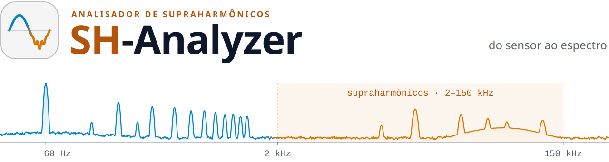
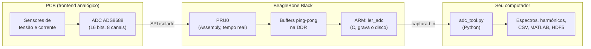
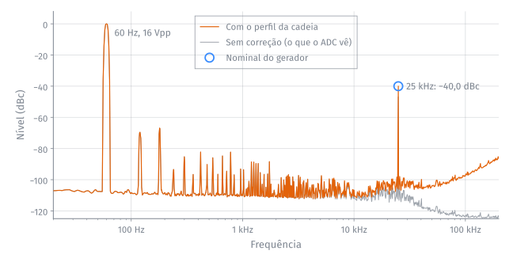
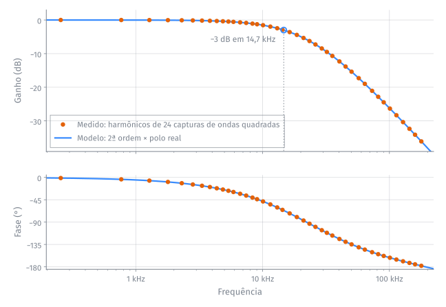

<p align="center">
  <picture>
    <source media="(prefers-color-scheme: dark)" srcset="docs/images/banner-logo-spectrum-dark.svg">
    
  </picture>
</p>

<p align="center">
  <a href="https://github.com/Canela-san/SH-Analyzer/actions/workflows/ci.yml"></a>
  <a href="https://github.com/Canela-san/SH-Analyzer/releases/latest"></a>
  
  
  <a href="LICENSE"></a>
</p>

<p align="center">
  Um projeto de hardware e software embarcado de alto desempenho para a identificação e análise de supraharmônicos em redes e cargas elétricas, utilizando uma PCB customizada e o microcomputador industrial BeagleBone.
</p>

<p align="center">
  <a href="#-início-rápido"><b>Início rápido</b></a> ·
  <a href="docs/user-guide.md"><b>Guia de uso</b></a> ·
  <a href="docs/lab-procedure.md"><b>Roteiro de laboratório</b></a> ·
  <a href="#-medido-em-bancada"><b>Resultados</b></a> ·
  <a href="#-contexto-acadêmico"><b>Como citar</b></a>
</p>

## 📖 Por que supraharmônicos

Inversores fotovoltaicos, carregadores de veículos elétricos, lâmpadas LED e fontes chaveadas injetam na rede perturbações de **2 a 150 kHz**, os **supraharmônicos**. Elas podem aquecer capacitores, gerar ruído audível e atrapalhar a comunicação pela rede elétrica, e ficam acima da faixa que os analisadores de qualidade de energia convencionais costumam enxergar.

O SH-Analyzer é um instrumento aberto para medi-las, do sensor ao espectro:

* 🔌 **Hardware:** uma PCB própria (Altium Designer) que condiciona os sinais de tensão e corrente e isola galvanicamente a rede do resto do sistema.
* ⚡ **Firmware:** Assembly na PRU e C no ARM da BeagleBone Black. A PRU amostra o ADC ADS8688 (16 bits, 8 canais) em tempo real, com timing determinístico, sem sobrecarregar o processador.
* 📊 **Software:** ferramentas Python para visualizar, medir, calibrar sondas, analisar o espectro e exportar as capturas.

## 🧭 Como funciona



1. A **PRU**, um microcontrolador de tempo real dentro da BeagleBone, lê o ADC por SPI com timing exato e escreve as amostras em dois buffers alternados na memória.
2. O **ARM** (o Linux) só copia os blocos prontos para um arquivo `.bin`. Nada é processado durante a captura.
3. A análise acontece **depois**, no seu computador.

Essa separação é proposital: o projeto põe a **integridade dos dados** acima de tudo. Cada `.bin` começa com um cabeçalho de 4096 bytes protegido por CRC-32 (que guarda também o CRC-32 das amostras), com a taxa, os canais, a grandeza, a sonda e a faixa de entrada de cada canal, a versão do firmware e os contadores de integridade da captura (amostras atrasadas, buffers sobrescritos). O arquivo se descreve sozinho.

## ✨ O que ele faz

**Na BeagleBone**

* Captura de 1 a 8 canais a até **400 kS/s no total** (período constante até 419 kS/s), com a grade de tempo exata: cada amostra sai no ciclo previsto, e a captura registra a própria integridade.
* A faixa de entrada do ADC escolhida por canal (±10,24 / ±5,12 / ±2,56 V).
* Capturas de segundos a horas (`--duracao 10m`, `1.5h`): o ARM grava um bloco enquanto a PRU enche o outro.
* As coletas de bancada num script só, `./coletar.sh MODO`: a conferência antes de uma série (`conferir`), a calibração por ondas quadradas (`calibrar`), a calibração por senoides (`sonda`), o ruído, o *aliasing* e o limite de taxa.

**No computador**

* **Harmônicos:** FFT sincronizada com a rede, componentes, subgrupos e grupos da IEC 61000-4-7, THD, THDS e THDG.
* **Supraharmônicos:** espectro médio (Welch), lista de picos, espectrograma e bandas de 200 Hz de 2 a 9 kHz, com a agregação de 3 s e 10 min da IEC 61000-4-30.
* **Correção da cadeia:** cada canal é corrigido pela resposta em frequência medida da cadeia inteira (sonda, condicionamento e o filtro interno do ADC).
* **Calibração sem instrumento de referência** (`medir_fase.py`): magnitude e fase da cadeia pelos harmônicos de ondas quadradas, com o ajuste do modelo e o teste de fase mínima.
* **Sonda de corrente com magnitude e fase** (`medir_fase.py --canal-referencia`): a razão de dois canais capturados juntos (o TC e a tensão num resistor do laço), com a fase absoluta e a diafonia subtraída.
* **Métricas de bancada** (`medir_captura.py`): ruído, THD, SINAD, ENOB, SFDR, diafonia e a continuidade da grade de tempo.
* **Exportação reprodutível:** CSV, JSON com os metadados que geraram o resultado, MATLAB e um HDF5 autossuficiente, que leva o cabeçalho original, os perfis das sondas e a proveniência.

## 📏 Medido em bancada

Um supraharmônico de 25 kHz, 40 dB abaixo de um 60 Hz de 16 Vpp, medido pelo canal de tensão a 400 kS/s (23/10/2026). Sem correção, o filtro interno do ADC o mostra 6,9 dB abaixo do real; com o perfil da cadeia, ele sai no nível do gerador, a 0,03 dB:

<p align="center">
  
  <br>
  <sub>60 Hz de 16 Vpp somado a 25 kHz de 0,16 Vpp, 30 s a 400 kS/s; Welch com 1 Hz de resolução. Figura gerada por <a href="report/gerar_figuras.py"><code>report/gerar_figuras.py</code></a> (<code>readme_espectro</code>).</sub>
</p>

A correção vem da resposta da cadeia de tensão, medida em magnitude **e** fase pelos harmônicos de ondas quadradas, sem instrumento de referência. Dez senoides de amplitude conhecida, de 60 Hz a 270 kHz, caem sobre ela a ±0,05 dB:

<p align="center">
  
  <br>
  <sub>Magnitude e fase da cadeia de tensão (divisor + filtro interno do ADC) de 256 Hz a 178,5 kHz, com o modelo ajustado: dois polos reais em 22,8 kHz e um em 800 kHz. Figura gerada por <a href="report/gerar_figuras.py"><code>report/gerar_figuras.py</code></a> (<code>readme_cadeia_tensao</code>).</sub>
</p>

| Medida | Resultado |
|---|---|
| Taxa de amostragem | **400 kS/s** com 1 canal; período constante até 419,3 kS/s |
| Integridade | 0 amostras atrasadas e 0 leituras divergentes em ~140 milhões de quadros; jitter de 0,00 ns |
| Ruído com a entrada em curto (±10,24 / ±5,12 / ±2,56 V) | 169 / 95 / 62 µV RMS, o do datasheet |
| Escala e linearidade | erro ≤ 0,08 % nas três faixas; resíduo ≤ 0,22 LSB |
| Cadeia de tensão | −3 dB em 14,7 kHz; magnitude e fase até 178 kHz, com resíduo de 0,01 dB e 0,14° |
| Validação por senoides | 10 tons de 60 Hz a 270 kHz a ±0,05 dB do perfil |
| Supraharmônico mais fraco medido | 9 kHz a −70 dBc do 60 Hz, 59 dB acima do piso |
| Menor tom detectável (30 s, ±2,56 V) | 8 µV de pico em 9 kHz; 105 µV em 180 kHz |
| Diafonia entre canais | −95,5 dB |

Os números completos, com a data, o firmware e a pasta dos dados de cada um, estão em [`docs/bench-results.md`](docs/bench-results.md).

> [!IMPORTANT]
> O ADS8688 tem um passa-baixa de 2ª ordem em cada canal (dois polos reais em 22,8 kHz) que não dá para desligar. Na banda dos supraharmônicos, o sinal chega ao conversor atenuado em dezenas de dB: a correção pelo perfil devolve a amplitude, mas multiplica o ruído na mesma proporção, e um componente acima da Nyquist dobra para dentro da banda atenuado só pelo mesmo filtro (um de 270 kHz aparece em 130 kHz, 43,5 dB abaixo). Por isso o perfil de cada canal é medido sobre a cadeia inteira. Os detalhes estão em [Sondas: calibração e correção](docs/user-guide.md#sondas-de-corrente-calibração-e-correção) e nos [limites conhecidos](docs/project-context.md).

## 🚀 Início rápido

Você precisa de duas máquinas: a **BeagleBone** (captura) e o **seu computador** (análise).

> [!WARNING]
> **Ligue a fonte de 5 V na BeagleBone.** A placa de aquisição recebe o +5 V por um pino que a BeagleBone só energiza pela entrada da fonte: alimentada só pelo USB, ela liga, mas o ADC fica desligado (o `ler_adc` para com "o ADC não está respondendo"). O USB continua sendo a ligação com o computador.

### 1. Capturar

Com a BeagleBone na fonte e ligada ao computador por USB, o `BeagleBone_Setup.sh` faz tudo do computador: acerta o relógio dela, leva o firmware, compila e carrega a PRU. Ela precisa do `gcc` e do compilador `clpru` da Texas Instruments.

```bash
scripts/BeagleBone_Setup.sh preparar
```

Depois, abra um terminal na pasta do firmware (o sudo já vem liberado) e capture:

```bash
scripts/BeagleBone_Setup.sh ssh
```

```bash
sudo ./ler_adc --duracao 10s
```

O resultado é um `captura_AAAAMMDD_HHMMSS.bin`: cerca de 10 s a 400 kS/s (a taxa padrão) no canal 1. Todas as opções estão em `sudo ./ler_adc --help`.

### 2. Analisar

Traga o `.bin` para o computador (`scripts/BeagleBone_Setup.sh trazer`) e instale o [`uv`](https://docs.astral.sh/uv/). Ele baixa as dependências Python na primeira execução, sem `pip install` nem ambiente virtual manual.

```bash
uv run scripts/adc_tool.py info captura.bin                      # o que é a captura: cabeçalho, canais, integridade
uv run scripts/adc_tool.py captura.bin --fft --harmonicos 40     # fundamental, harmônicos (IEC 61000-4-7), THD
uv run scripts/adc_tool.py captura.bin --welch --picos -60       # supraharmônicos: espectro médio e lista de picos
uv run scripts/adc_tool.py captura.bin --export-hdf5 captura.h5  # tudo num HDF5, com metadados e perfis de sonda
```

A taxa, os canais e as faixas vêm do cabeçalho, então não é preciso informá-los. A ajuda completa está em `uv run scripts/adc_tool.py --help`.

### Para ir além

| Quero... | Use | Onde ler |
|---|---|---|
| Harmônicos com grupos e fases, bandas IEC, espectrograma, exportar para MATLAB | `adc_tool.py` | [Análise para pesquisa](docs/user-guide.md#análise-para-pesquisa-harmônicos-bandas-iec-espectrograma-e-exportação) |
| Conferir a bancada antes de uma série de capturas | `coletar.sh conferir` | [Guia de uso](docs/user-guide.md) |
| Calibrar a cadeia (magnitude e fase) por ondas quadradas, sem instrumento de referência | `coletar.sh calibrar` e `medir_fase.py` | [A calibração por ondas quadradas](docs/user-guide.md#a-calibração-por-ondas-quadradas-medir_fasepy) |
| Calibrar a sonda de corrente com a fase (dois canais juntos) | `coletar.sh calibrar --canal-referencia` e `medir_fase.py --canal-referencia` | [A razão de dois canais](docs/user-guide.md#a-razão-de-dois-canais---canal-referencia) |
| Calibrar por senoides, ponto a ponto | `coletar.sh sonda` → `gerar_perfil_sonda.py` | [Sondas: calibração e correção](docs/user-guide.md#sondas-de-corrente-calibração-e-correção) |
| Medir ruído, SINAD, ENOB e diafonia para o relatório | `medir_captura.py` | [Medir uma captura](docs/user-guide.md#medir-uma-captura-para-o-relatório-medir_capturapy) |
| Gerar as figuras do relatório e do README | `report/gerar_figuras.py` | [`docs/bench-results.md`](docs/bench-results.md) |
| Arquivar capturas sem perdas (~11 % do tamanho, conferido bit a bit) | `compactar_amostras.py` | [Guardar as capturas](docs/user-guide.md#guardar-as-capturas-sem-perdas-compactar_amostraspy) |
| Saber onde guardar os dados | a variável `DADOS` | [Onde guardar os dados](docs/user-guide.md#onde-guardar-os-dados) |
| Validar o instrumento em bancada | testes T0 a T11 | [Roteiro de laboratório](docs/lab-procedure.md) |

## 📈 FFT ou Welch?

| Quero medir... | Use | Por quê |
|---|---|---|
| Fundamental (60 Hz) e harmônicos | `--fft` | Corta o sinal em ciclos inteiros da rede, o que elimina o vazamento espectral |
| Supraharmônicos | `--welch` | Eles não têm relação de fase com a rede, e a frequência de chaveamento oscila. A média de vários segmentos dá um espectro estável |

As duas podem ser combinadas na mesma execução. A explicação completa, com os cuidados de cada uma, está no [guia de uso](docs/user-guide.md#fft-ou-welch).

## ✅ Estado do projeto

| Situação | O que |
|---|---|
| ✅ Validado em hardware | Aquisição a 400 kS/s com a grade de tempo exata e a integridade medida em cada captura (T7f e T7g); a cadeia de tensão em magnitude e fase até 178 kHz (T3f), confirmada por senoides até 270 kHz; *aliasing* (T8) e supraharmônicos de espectro conhecido (T9) |
| 📏 Medido com o firmware anterior, a refazer | Escala, razão do divisor, exatidão da taxa e atraso entre canais (T0, T2, T4 e T6) |
| 🧪 Validado com dados sintéticos | A calibração da sonda de corrente com magnitude e fase pela razão de dois canais; a análise espectral e a correção |
| ⏳ Pendente | **A calibração da sonda de corrente em bancada (T10)**, a cadeia de tensão na faixa de produção (±10,24 V), uma carga real (T11) e a distorção com fonte limpa (T5) |

O andamento, teste a teste, está no [Estado da campanha](docs/lab-procedure.md#estado-da-campanha), e o caminho até o relatório final no [plano do relatório](docs/final-report-plan.md).

## 📂 Estrutura do repositório

```text
.
├── firmware/          # BeagleBone: PRU (spi_core.asm, pru_main.c), ler_adc.c, Makefile, setup.sh, coletar.sh (+ coleta/)
├── scripts/           # Computador: adc_tool.py e as outras entradas, o pacote supraharmonicos/, os perfis de sonda
│                      #   (sondas/), BeagleBone_Setup.sh (a interface com a placa) e ci.sh (a CI local)
├── tests/             # Testes automáticos (pytest), sem precisar de hardware, e o simulador da PRU
├── report/            # gerar_figuras.py: as figuras do relatório num estilo só; gerar_marca.py: banner, logo e ícone
├── hardware/          # Projeto da PCB no Altium Designer (DAQ_Module)
├── docs/              # Documentação (tabela abaixo), datasheets, documentos da FAPESP e imagens
├── pyproject.toml     # Dependências e configuração de pytest e ruff
└── CITATION.cff       # Como citar o projeto
```

Pastas e documentos têm nomes em inglês, minúsculos e sem espaço; o código (módulos, comandos, opções) e o texto dos documentos são em português.

## 📚 Documentação

| Documento | Para quem | Conteúdo |
|---|---|---|
| [`docs/user-guide.md`](docs/user-guide.md) | Quem vai **usar** | Passo a passo: capturar, analisar, calibrar sondas, formato do `.bin`, problemas comuns |
| [`docs/lab-procedure.md`](docs/lab-procedure.md) | Quem vai **testar em bancada** | Testes T0 a T11: sinal a injetar, comandos, o que anotar, critérios de aceitação e o passo a passo da próxima ida |
| [`docs/bench-results.md`](docs/bench-results.md) | Quem vai **citar um resultado** | Os números medidos, teste a teste, com a data, o firmware, a pasta dos dados e as figuras |
| [`docs/software-architecture.md`](docs/software-architecture.md) | Quem vai **modificar o Python** | Módulos e camadas, convenções, testes, CI, receitas e checklist de PR |
| [`docs/project-context.md`](docs/project-context.md) | Quem quer a **referência técnica completa** | Protocolo SPI, firmware, formato do cabeçalho, pipeline de análise, estado e limites (texto denso, escrito também para ser lido por IA) |
| [`docs/improvement-proposals.md`](docs/improvement-proposals.md) | Quem vai **evoluir o projeto** | Melhorias abertas, com prioridade e esforço |
| [`docs/probe-profile-audit.md`](docs/probe-profile-audit.md) | Quem confia na **calibração de sondas** | Auditoria do perfil e da correção: evidências, bugs corrigidos, limites |
| [`docs/probe-correction-design.md`](docs/probe-correction-design.md) | Quem quer saber **por que** foi feito assim | Raciocínio de projeto da correção de sondas (histórico) |
| [`docs/final-report-plan.md`](docs/final-report-plan.md) | Quem escreve **o relatório final** | O que já está demonstrado, o que falta em cada seção, as idas ao laboratório e o cronograma |
| [`docs/report-notes.md`](docs/report-notes.md) | Quem escreve **relatório ou apresentação** | Notas cronológicas e os números para citar |
| [`report/gerar_figuras.py`](report/gerar_figuras.py) | Quem escreve **relatório ou artigo** | Figuras em PDF vetorial no tamanho final, com o texto pelo LaTeX, e os números citados como macros siunitx |

## 🤝 Contribuindo

Quem for modificar o código Python deve começar por [`docs/software-architecture.md`](docs/software-architecture.md). A CI do GitHub roda o `scripts/ci.sh`, e você roda o mesmo script na sua máquina, com as mesmas versões das ferramentas:

```bash
scripts/ci.sh rapido      # antes de cada commit (~30 s): ruff, testes sem os e2e, gcc e shellcheck
scripts/ci.sh             # tudo o que a CI roda (~3 min): Python 3.10 e 3.13, com os e2e, e o firmware
```

Nenhum teste precisa de hardware. Eles também conferem que o firmware (C) e o Python concordam sobre o formato do cabeçalho: se você mudar um lado, o `pytest` avisa até o outro acompanhar. O que cada arquivo de teste cobre está em [`docs/software-architecture.md`](docs/software-architecture.md#7-testes).

## 🎓 Contexto acadêmico

Resultado prático de uma pesquisa de Iniciação Científica (IC), vinculada ao projeto "Sistema de identificação da presença de supraharmônicos em redes e cargas elétricas", desenvolvida no curso de Engenharia de Controle e Automação da Universidade Estadual de Campinas (Unicamp), com apoio da FAPESP (processo 2025/22891-1).

* **Orientação:** Prof. Dr. José Antenor Pomilio.
* **Coorientação:** Dr. Mateus Pinheiro Dias.

Um agradecimento especial a ambos pela orientação contínua, pela excelência técnica e pelo suporte ao longo de toda a pesquisa.

**Como citar:** use o [`CITATION.cff`](CITATION.cff). No GitHub, o botão "Cite this repository", na lateral da página, gera a referência em APA e BibTeX.

## 📄 Licença

Distribuído sob a Licença MIT. Veja o arquivo [`LICENSE`](LICENSE).
