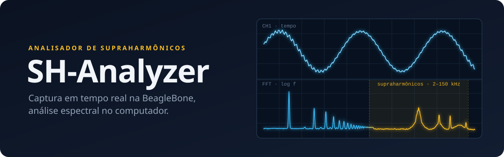
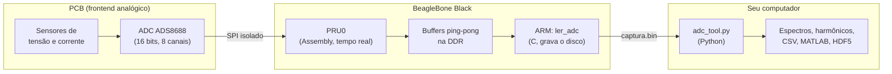
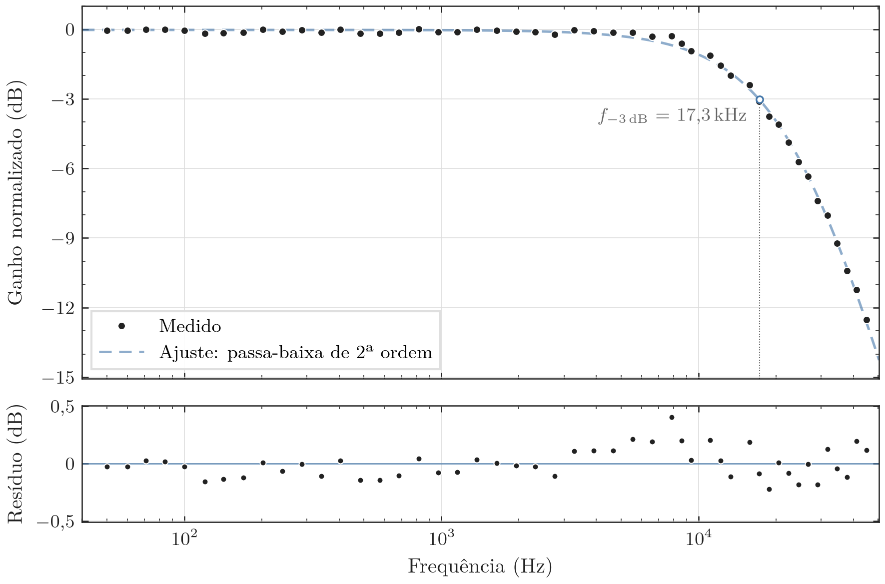

<p align="center">
  
</p>

<p align="center">
  <a href="https://github.com/Canela-san/SH-Analyzer/actions/workflows/ci.yml"></a>
  <a href="https://github.com/Canela-san/SH-Analyzer/releases/latest"></a>
  
  
  <a href="LICENSE"></a>
</p>

<p align="center">
  Um projeto de hardware e software embarcado de alto desempenho para a identificação e análise de supraharmônicos em redes e cargas elétricas, utilizando uma PCB customizada e o microcomputador industrial BeagleBone.
</p>

<p align="center">
  <a href="#-início-rápido"><b>Início rápido</b></a> ·
  <a href="docs/user-guide.md"><b>Guia de uso</b></a> ·
  <a href="docs/lab-procedure.md"><b>Roteiro de laboratório</b></a> ·
  <a href="#-medido-em-bancada"><b>Resultados</b></a> ·
  <a href="#-contexto-acadêmico"><b>Como citar</b></a>
</p>

## 📖 Por que supraharmônicos

Inversores fotovoltaicos, carregadores de veículos elétricos, lâmpadas LED e fontes chaveadas injetam na rede perturbações de **2 a 150 kHz**, os **supraharmônicos**. Elas podem aquecer capacitores, gerar ruído audível e atrapalhar a comunicação pela rede elétrica, e ficam acima da faixa que os analisadores de qualidade de energia convencionais costumam enxergar.

O SH-Analyzer é um instrumento aberto para medi-las, do sensor ao espectro:

* 🔌 **Hardware:** uma PCB própria (Altium Designer) que condiciona os sinais de tensão e corrente e isola galvanicamente a rede do resto do sistema.
* ⚡ **Firmware:** Assembly na PRU e C no ARM da BeagleBone Black. A PRU amostra o ADC ADS8688 (16 bits, 8 canais) em tempo real, com timing determinístico, sem sobrecarregar o processador.
* 📊 **Software:** ferramentas Python para visualizar, medir, calibrar sondas, analisar o espectro e exportar as capturas.

## 🧭 Como funciona



1. A **PRU**, um microcontrolador de tempo real dentro da BeagleBone, lê o ADC por SPI com timing exato e escreve as amostras em dois buffers alternados na memória.
2. O **ARM** (o Linux) só copia os blocos prontos para um arquivo `.bin`. Nada é processado durante a captura.
3. A análise acontece **depois**, no seu computador.

Essa separação é proposital: o projeto põe a **integridade dos dados** acima de tudo. Cada `.bin` começa com um cabeçalho de 1024 bytes protegido por CRC-32, com a taxa, os canais, a grandeza, a sonda e a faixa de entrada de cada canal, a versão do firmware e os contadores de integridade da captura (amostras atrasadas, buffers sobrescritos). O arquivo se descreve sozinho.

## ✨ O que ele faz

**Na BeagleBone**

* Captura de 1 a 8 canais, com a faixa de entrada do ADC escolhida por canal (±10,24 / ±5,12 / ±2,56 V).
* Capturas de segundos a horas (`--duracao 10m`, `1.5h`): o ARM grava um bloco enquanto a PRU enche o outro.
* Calibração de sondas em bancada (`calibrar_sonda.sh`): escolhe as frequências, pede cada uma no gerador e confere cada captura.

**No computador**

* **Harmônicos:** FFT sincronizada com a rede, componentes e grupos da IEC 61000-4-7, THD e THDG.
* **Supraharmônicos:** espectro médio (Welch), lista de picos, espectrograma e bandas de 200 Hz de 2 a 9 kHz, com a agregação de 3 s e 10 min da IEC 61000-4-30.
* **Sondas:** cada canal é corrigido pela resposta em frequência medida da sua cadeia (sonda, frontend e ADC).
* **Métricas de bancada** (`medir_captura.py`): ruído, THD, SINAD, ENOB, SFDR, diafonia e a continuidade da grade de tempo.
* **Exportação reprodutível:** CSV, JSON com os metadados que geraram o resultado, MATLAB e um HDF5 autossuficiente, que leva o cabeçalho original, os perfis das sondas e a proveniência.

## 📏 Medido em bancada

O primeiro dia de bancada (19/10/2026) caracterizou o ADC e a cadeia de tensão contra um osciloscópio:

<p align="center">
  
  <br>
  <sub>Resposta em frequência da cadeia de tensão (T3): 48 pontos de 50 Hz a 45 kHz, ajustados a um passa-baixa de 2ª ordem (f<sub>0</sub> = 24,1 kHz, Q = 0,54). Figura gerada por <a href="report/gerar_figuras.py"><code>report/gerar_figuras.py</code></a>.</sub>
</p>

| Medida | Resultado |
|---|---|
| Escala, nas três faixas de entrada | erro ≤ 0,08 % |
| Ruído com a entrada em curto (±10,24 / ±5,12 / ±2,56 V) | 160 / 91 / 58 µV RMS, igual ao datasheet |
| Linearidade | resíduo ≤ 0,22 LSB |
| Diafonia entre canais | −94,7 dB |
| Taxa de amostragem | 200 MHz ÷ ticks, confirmada a 0,02 ppm; estável a 0,09 ppm em 10 min |
| Cadeia de tensão | −3 dB em 17,3 kHz; −12,5 dB em 45 kHz |

> [!IMPORTANT]
> O ADS8688 tem um filtro passa-baixa de 2ª ordem embutido em cada canal (corte de ~15 kHz, pelo datasheet), que não dá para desligar: é ele que derruba a curva acima. Na banda dos supraharmônicos, o sinal chega ao conversor atenuado em dezenas de dB, e a correção por perfil devolve a amplitude, mas amplifica o ruído na mesma proporção. Por isso o perfil de cada canal é medido sobre a cadeia inteira (sonda, frontend e ADC). Além disso, a taxa de amostragem de hoje (até ~140 kS/s) cobre só parte da banda. Os detalhes estão em [Sondas: calibração e correção](docs/user-guide.md#sondas-de-corrente-calibração-e-correção) e nos [limites conhecidos](docs/project-context.md).

## 🚀 Início rápido

Você precisa de duas máquinas: a **BeagleBone** (captura) e o **seu computador** (análise).

### 1. Capturar

No computador, leve o firmware para a BeagleBone e compile lá. Ela precisa do `gcc` e do compilador `clpru` da Texas Instruments.

```bash
scripts/enviar_firmware.sh --setup
```

Na BeagleBone:

```bash
cd firmware
sudo ./ler_adc 100000 --duracao 10s
```

O resultado é um `captura_AAAAMMDD_HHMMSS.bin`: cerca de 10 s a 100 kS/s no canal 1. Todas as opções estão em `sudo ./ler_adc --help`.

### 2. Analisar

Copie o `.bin` para o computador (com `scp`, por exemplo) e instale o [`uv`](https://docs.astral.sh/uv/). Ele baixa as dependências Python na primeira execução, sem `pip install` nem ambiente virtual manual.

```bash
uv run scripts/adc_tool.py info captura.bin                      # o que é a captura: cabeçalho, canais, integridade
uv run scripts/adc_tool.py captura.bin --fft --harmonicos 40     # fundamental, harmônicos (IEC 61000-4-7), THD
uv run scripts/adc_tool.py captura.bin --welch --picos -60       # supraharmônicos: espectro médio e lista de picos
uv run scripts/adc_tool.py captura.bin --export-hdf5 captura.h5  # tudo num HDF5, com metadados e perfis de sonda
```

A taxa, os canais e as faixas vêm do cabeçalho, então não é preciso informá-los. A ajuda completa está em `uv run scripts/adc_tool.py --help`.

### Para ir além

| Quero... | Use | Onde ler |
|---|---|---|
| Harmônicos com grupos e fases, bandas IEC, espectrograma, exportar para MATLAB | `adc_tool.py` | [Análise para pesquisa](docs/user-guide.md#análise-para-pesquisa-harmônicos-bandas-iec-espectrograma-e-exportação) |
| Calibrar uma sonda de corrente ou a cadeia de tensão | `calibrar_sonda.sh` → `gerar_perfil_sonda.py` | [Sondas: calibração e correção](docs/user-guide.md#sondas-de-corrente-calibração-e-correção) |
| Medir ruído, SINAD, ENOB e diafonia para o relatório | `medir_captura.py` | [Medir uma captura](docs/user-guide.md#medir-uma-captura-para-o-relatório-medir_capturapy) |
| Arquivar capturas sem perdas (~11 % do tamanho, conferido bit a bit) | `compactar_amostras.py` | [Guardar as capturas](docs/user-guide.md#guardar-as-capturas-sem-perdas-compactar_amostraspy) |
| Saber onde guardar os dados | a variável `DADOS` | [Onde guardar os dados](docs/user-guide.md#onde-guardar-os-dados) |
| Validar o instrumento em bancada | testes T0 a T11 | [Roteiro de laboratório](docs/lab-procedure.md) |

## 📈 FFT ou Welch?

| Quero medir... | Use | Por quê |
|---|---|---|
| Fundamental (60 Hz) e harmônicos | `--fft` | Corta o sinal em ciclos inteiros da rede, o que elimina o vazamento espectral |
| Supraharmônicos | `--welch` | Eles não têm relação de fase com a rede, e a frequência de chaveamento oscila. A média de vários segmentos dá um espectro estável |

As duas podem ser combinadas na mesma execução. A explicação completa, com os cuidados de cada uma, está no [guia de uso](docs/user-guide.md#fft-ou-welch).

## ✅ Estado do projeto

| Situação | O que |
|---|---|
| ✅ Validado em hardware | Protocolo SPI do ADS8688, handshake ARM↔PRU e varredura automática de canais (1 e 5 canais a 102,4 kS/s): canais ligados à rede mostram os 60 Hz, canais desconectados mostram só ruído |
| 📏 Medido em bancada | ADC e aquisição (T0 a T4, T6 e T7, alguns com pontos a refazer) e resposta em frequência da cadeia de tensão (T3), na [tabela acima](#-medido-em-bancada) |
| 🧪 Validado com sinais sintéticos | Toda a análise espectral, a correção de sondas e a geração de perfis |
| 🛠️ Corrigido, falta validar em hardware | O firmware anterior a out/2026 perdia 6,97 µs a cada troca de buffer. A correção e os contadores de integridade foram conferidos num simulador da PRU; falta refazer o T7 na BeagleBone |
| ⏳ Pendente | Teto da taxa de amostragem (T7e), **calibração da sonda de corrente** (T10), distorção, *aliasing* e ensaios ponta a ponta (T5, T8, T9, T11), fase da cadeia |

O andamento, teste a teste, está no [Estado da campanha](docs/lab-procedure.md#estado-da-campanha).

## 📂 Estrutura do repositório

```text
.
├── firmware/          # BeagleBone: PRU (spi_core.asm, pru_main.c), ler_adc.c, Makefile, setup.sh, calibrar_sonda.sh
├── scripts/           # Computador: adc_tool.py e as outras entradas, o pacote supraharmonicos/, os perfis de sonda
│                      #   (sondas/), enviar_firmware.sh, set_date.sh e ci.sh (a CI local)
├── tests/             # Testes automáticos (pytest), sem precisar de hardware, e o simulador da PRU
├── report/            # gerar_figuras.py: as figuras do relatório num estilo só
├── hardware/          # Projeto da PCB no Altium Designer (DAQ_Module)
├── docs/              # Documentação (tabela abaixo), datasheets, documentos da FAPESP e imagens
├── pyproject.toml     # Dependências e configuração de pytest e ruff
└── CITATION.cff       # Como citar o projeto
```

Pastas e documentos têm nomes em inglês, minúsculos e sem espaço; o código (módulos, comandos, opções) e o texto dos documentos são em português.

## 📚 Documentação

| Documento | Para quem | Conteúdo |
|---|---|---|
| [`docs/user-guide.md`](docs/user-guide.md) | Quem vai **usar** | Passo a passo: capturar, analisar, calibrar sondas, formato do `.bin`, problemas comuns |
| [`docs/lab-procedure.md`](docs/lab-procedure.md) | Quem vai **testar em bancada** | Testes T0 a T11: sinal a injetar, comandos, o que anotar no osciloscópio, critérios de aceitação e dados para o relatório |
| [`docs/software-architecture.md`](docs/software-architecture.md) | Quem vai **modificar o Python** | Módulos e camadas, convenções, testes, CI, receitas e checklist de PR |
| [`docs/project-context.md`](docs/project-context.md) | Quem quer a **referência técnica completa** | Protocolo SPI, firmware, formato do cabeçalho, pipeline de análise, estado e limites (texto denso, escrito também para ser lido por IA) |
| [`docs/improvement-proposals.md`](docs/improvement-proposals.md) | Quem vai **evoluir o projeto** | Melhorias abertas, com prioridade e esforço |
| [`docs/probe-profile-audit.md`](docs/probe-profile-audit.md) | Quem confia na **calibração de sondas** | Auditoria do perfil e da correção: evidências, bugs corrigidos, limites |
| [`docs/probe-correction-design.md`](docs/probe-correction-design.md) | Quem quer saber **por que** foi feito assim | Raciocínio de projeto da correção de sondas (histórico) |
| [`docs/report-notes.md`](docs/report-notes.md) | Quem escreve **relatório ou apresentação** | Notas cronológicas e os números para citar |
| [`report/gerar_figuras.py`](report/gerar_figuras.py) | Quem escreve **relatório ou artigo** | Figuras em PDF vetorial no tamanho final, com o texto pelo LaTeX, e os números citados como macros siunitx |

## 🤝 Contribuindo

Quem for modificar o código Python deve começar por [`docs/software-architecture.md`](docs/software-architecture.md). A CI do GitHub roda o `scripts/ci.sh`, e você roda o mesmo script na sua máquina, com as mesmas versões das ferramentas:

```bash
scripts/ci.sh rapido      # antes de cada commit (~30 s): ruff, testes sem os e2e, gcc e shellcheck
scripts/ci.sh             # tudo o que a CI roda (~3 min): Python 3.10 e 3.13, com os e2e, e o firmware
```

Nenhum teste precisa de hardware. Eles também conferem que o firmware (C) e o Python concordam sobre o formato do cabeçalho: se você mudar um lado, o `pytest` avisa até o outro acompanhar. O que cada arquivo de teste cobre está em [`docs/software-architecture.md`](docs/software-architecture.md#7-testes).

## 🎓 Contexto acadêmico

Resultado prático de uma pesquisa de Iniciação Científica (IC), vinculada ao projeto "Sistema de identificação da presença de supraharmônicos em redes e cargas elétricas", desenvolvida no curso de Engenharia de Controle e Automação da Universidade Estadual de Campinas (Unicamp), com apoio da FAPESP (processo 2025/22891-1).

* **Orientação:** Prof. Dr. José Antenor Pomilio.
* **Coorientação:** Dr. Mateus Pinheiro Dias.

Um agradecimento especial a ambos pela orientação contínua, pela excelência técnica e pelo suporte ao longo de toda a pesquisa.

**Como citar:** use o [`CITATION.cff`](CITATION.cff). No GitHub, o botão "Cite this repository", na lateral da página, gera a referência em APA e BibTeX.

## 📄 Licença

Distribuído sob a Licença MIT. Veja o arquivo [`LICENSE`](LICENSE).
