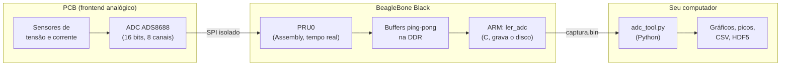

# SH-Analyzer

**Analisador de supraharmônicos:** Um projeto de hardware e software embarcado de alto desempenho para a identificação e análise de supraharmônicos em redes e cargas elétricas, utilizando uma PCB customizada e o microcomputador industrial BeagleBone.

Captura tensão e corrente da rede elétrica em alta taxa de amostragem (BeagleBone Black + ADC ADS8688) e analisa o espectro com ferramentas Python.

[](https://github.com/Canela-san/SH-Analyzer/actions/workflows/ci.yml)
[](https://opensource.org/licenses/MIT)

## 📖 O que é

Conversores eletrônicos de potência (carregadores, inversores, fontes chaveadas) injetam perturbações de alta frequência na rede, na faixa de dezenas de kHz, chamadas **supraharmônicos**. Os analisadores de qualidade de energia convencionais costumam não enxergá-las.

O SH-Analyzer é um instrumento completo para medi-las:

* **Hardware:** uma PCB própria (Altium Designer) que condiciona os sinais e isola galvanicamente a rede do resto do sistema.
* **Firmware:** C e Assembly para a BeagleBone Black, que amostram o ADC em tempo real com timing determinístico, sem sobrecarregar o processador.
* **Software:** ferramentas Python para visualizar, converter, exportar (HDF5) e analisar o espectro das capturas.

## 🧭 Como funciona



1. A **PRU** (um microcontrolador de tempo real dentro da BeagleBone) lê o ADC por SPI com timing exato e escreve as amostras em dois buffers alternados na memória.
2. O **ARM** (o Linux) só copia os blocos prontos para um arquivo `.bin`. Nenhum processamento acontece durante a captura.
3. A análise (FFT, Welch, supraharmônicos, calibração de sondas) acontece **depois**, no seu computador.

Essa separação é proposital: o projeto prioriza a **integridade dos dados** sobre qualquer outra coisa. Cada `.bin` carrega um cabeçalho de 1024 bytes (frequência, canais, grandeza, sonda e faixa de entrada do ADC de cada canal, título, CRC-32), então o arquivo se descreve sozinho.

## 🚀 Início rápido

Você precisa de duas máquinas: a **BeagleBone** (captura) e o **seu computador** (análise).

### 1. Capturar (na BeagleBone)

Pré-requisitos: `gcc` e o compilador `clpru` da Texas Instruments.

```bash
cd firmware
./setup.sh                           # configura os pinos, compila e carrega o firmware na PRU
sudo ./ler_adc 102400 --duracao 10s  # captura ~10 s a 102,4 kHz no canal 1
```

O resultado é um arquivo `captura_AAAAMMDD_HHMMSS.bin`. Veja todas as opções com `sudo ./ler_adc --help`.

### 2. Analisar (no seu computador)

Copie o `.bin` para o computador (por exemplo, com `scp`) e instale o [`uv`](https://docs.astral.sh/uv/). Ele baixa as dependências Python sozinho na primeira execução, sem `pip install` nem ambiente virtual manual.

```bash
uv run scripts/adc_tool.py captura.bin --fft                # fundamental e harmônicos
uv run scripts/adc_tool.py captura.bin --welch --picos -60  # supraharmônicos: espectro médio e lista de picos
uv run scripts/adc_tool.py captura.bin --export-hdf5 captura.h5 --incluir-tensao
```

Frequência e canais vêm do cabeçalho da captura, então não é preciso informá-los. Ajuda completa: `uv run scripts/adc_tool.py --help`.

Para **medir** a captura (ruído, THD, SINAD, ENOB, SFDR, amostras perdidas, diafonia, comparação com um osciloscópio) e gerar uma tabela de números para o relatório:

```bash
uv run scripts/medir_captura.py captura.bin --csv resultados.csv
```

Mais exemplos (multi-canal, filtros, conversão para CSV, calibração de sondas de corrente) estão no **[guia de uso](docs/guia_de_uso.md)**. Vai validar o projeto em bancada? Use o **[roteiro de laboratório](docs/roteiro_laboratorio.md)**.

## 📈 FFT ou Welch?

| Quero medir... | Use | Por quê |
|---|---|---|
| Fundamental (60 Hz) e harmônicos | `--fft` | Corta o sinal em ciclos inteiros da rede, o que elimina o vazamento espectral |
| Supraharmônicos | `--welch` | Eles não têm relação de fase com a rede, e a frequência de chaveamento oscila. Média de vários segmentos dá um espectro estável |

As duas podem ser combinadas na mesma execução. A explicação completa, com os cuidados de cada uma, está no [guia de uso](docs/guia_de_uso.md#fft-ou-welch).

## 📂 Estrutura do repositório

```text
.
├── firmware/    # Código da BeagleBone: PRU (spi_core.asm, pru_main.c), ler_adc.c, Makefile, setup.sh, calibrar_sonda.sh
├── scripts/     # Python (adc_tool.py, gerar_perfil_sonda.py, medir_captura.py, pacote supraharmonicos/) e utilitários .sh
├── tests/       # Testes automáticos (pytest), sem precisar de hardware
├── hardware/    # Projeto da PCB no Altium Designer (DAQ_Module)
└── docs/        # Documentação, proposta de IC, datasheets e imagens
```

## 📚 Documentação

| Documento | Para quem | Conteúdo |
|---|---|---|
| [`docs/guia_de_uso.md`](docs/guia_de_uso.md) | Quem vai **usar** | Passo a passo: capturar, analisar, calibrar sondas, formato do `.bin`, problemas comuns |
| [`docs/roteiro_laboratorio.md`](docs/roteiro_laboratorio.md) | Quem vai **testar em bancada** | Lista de testes (T0 a T11): sinal a injetar, comandos, o que anotar no osciloscópio, critérios de aceitação e dados para o relatório |
| [`docs/arquitetura_software.md`](docs/arquitetura_software.md) | Quem vai **modificar o Python** | Módulos e camadas, convenções, testes, CI, receitas e checklist de PR |
| [`docs/contexto_projeto.md`](docs/contexto_projeto.md) | Quem quer a **referência técnica completa** | Protocolo SPI, firmware, formato do cabeçalho, pipeline de análise, status e limites (texto denso, escrito também para ser lido por IA) |
| [`docs/melhorias-propostas.md`](docs/melhorias-propostas.md) | Quem vai **evoluir o projeto** | Melhorias abertas, com prioridade e esforço |
| [`docs/auditoria_perfil_sonda.md`](docs/auditoria_perfil_sonda.md) | Quem confia na **calibração de sondas** | Auditoria do perfil e da correção: evidências, bugs corrigidos, limites |
| [`docs/proposta_correcao_sonda.md`](docs/proposta_correcao_sonda.md) | Quem quer saber **por que** foi feito assim | Raciocínio de projeto da correção de sondas (histórico) |
| [`docs/notas_relatorio.md`](docs/notas_relatorio.md) | Quem escreve **relatório ou apresentação** | Notas cronológicas, com pontos a confirmar |

## ✅ Estado de validação

| Situação | O que |
|---|---|
| ✅ Validado em hardware | Protocolo SPI do ADS8688 (32 ciclos de clock por amostra); handshake ARM↔PRU; varredura automática (AUTO_RST) com 1 e com 5 canais a 102,4 kHz totais (≈20,48 kHz por canal): canais ligados à rede mostram os 60 Hz, canais desconectados mostram só ruído |
| 🧪 Validado com sinais sintéticos | Toda a análise espectral (`--fft`, `--welch`, bandas, picos), a correção de sondas e a geração de perfis |
| ⏳ Pendente | **Validação quantitativa de exatidão:** medir amplitude e frequência de um sinal de referência calibrado, injetado em bancada (plano em [`docs/roteiro_laboratorio.md`](docs/roteiro_laboratorio.md)). Falta também calibrar uma sonda real, compilar com `clpru` e testar a faixa de entrada do ADC por canal (`ler_adc --faixa-adc`, só simulada até aqui) e conferir o cabeçalho v3 numa captura real |

**Atenção ao filtro do ADC:** o ADS8688 tem um filtro passa-baixa de 2ª ordem embutido em cada canal, com corte de cerca de 15 kHz (datasheet, seção 8.3.5). Na banda de supraharmônicos (2 a 150 kHz) o sinal chega ao conversor atenuado em dezenas de dB, e a correção por perfil devolve a amplitude mas amplifica o ruído na mesma proporção. Por isso o perfil deve cobrir a cadeia inteira (sonda, frontend e ADC) até 150 kHz; neste projeto "sonda" designa esse conjunto, e a frequência de corte do filtro do ADC não precisa ser conhecida, porque aparece na curva medida. O perfil pode ser montado a partir de uma **senoide de amplitude conhecida** (`calibrar_sonda.sh --amplitude 500mVpp`, gravada nos metadados de cada captura), de um `.m` do osciloscópio, de leituras anotadas ou de um segundo canal do ADC: veja [`docs/guia_de_uso.md`](docs/guia_de_uso.md#sondas-de-corrente-calibração-e-correção).

Limites conhecidos, como a ausência de controle de *overrun* nos buffers (risco cresce com a taxa de amostragem) e a correção de sonda só de magnitude, estão em [`docs/contexto_projeto.md`](docs/contexto_projeto.md) e [`docs/melhorias-propostas.md`](docs/melhorias-propostas.md).

## 🤝 Contribuindo

Quem for modificar o código Python deve começar por [`docs/arquitetura_software.md`](docs/arquitetura_software.md). Para rodar os testes e a checagem de estilo (os mesmos que o GitHub roda em todo pull request):

```bash
uv run --extra dev ruff check .   # estilo e erros comuns
uv run --extra dev pytest         # 483 testes, ~2 min (use -m "not e2e" para a versão rápida: 396 testes, ~10 s)
```

Os testes também conferem que o firmware (C) e o Python concordam sobre o formato do cabeçalho: se você mudar um lado, o `pytest` avisa até o outro acompanhar.

## 🎓 Contexto acadêmico

Resultado prático de uma pesquisa de Iniciação Científica (IC), vinculada ao projeto "Sistema de identificação da presença de supraharmônicos em redes e cargas elétricas", desenvolvida no curso de Engenharia de Controle e Automação da Universidade Estadual de Campinas (Unicamp).

* **Orientação:** Prof. Dr. José Antenor Pomilio.
* **Coorientação:** Dr. Mateus Pinheiro Dias.

Um agradecimento especial a ambos pela orientação contínua, pela excelência técnica e pelo suporte ao longo de toda a pesquisa.

## 📄 Licença

Distribuído sob a Licença MIT. Veja o arquivo [`LICENSE`](LICENSE).
