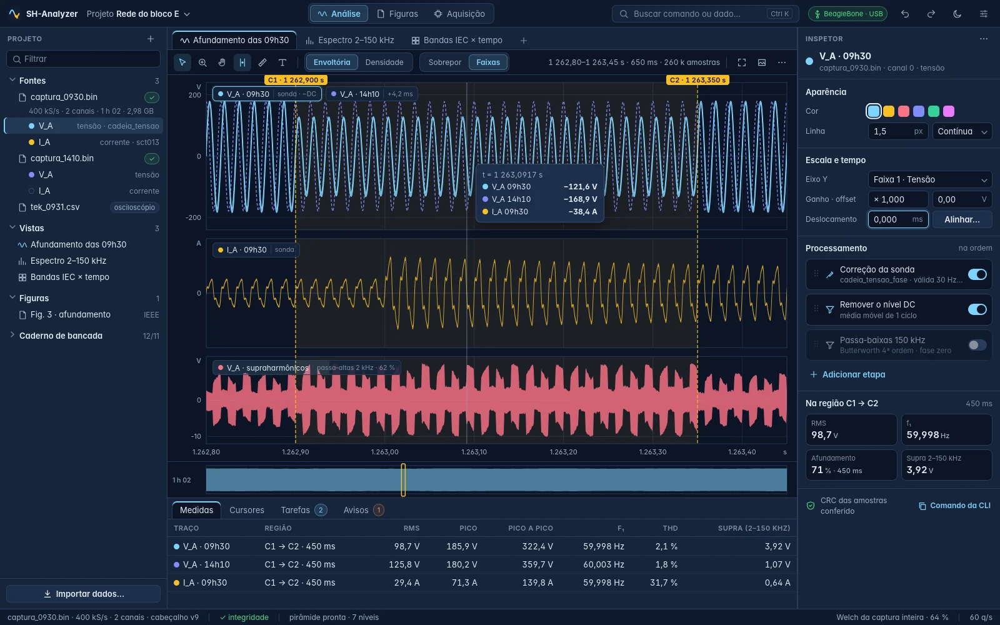
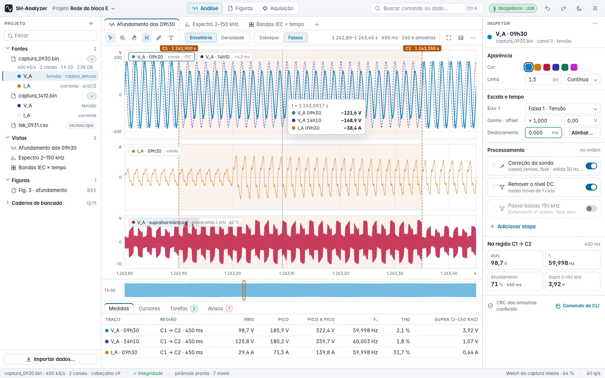
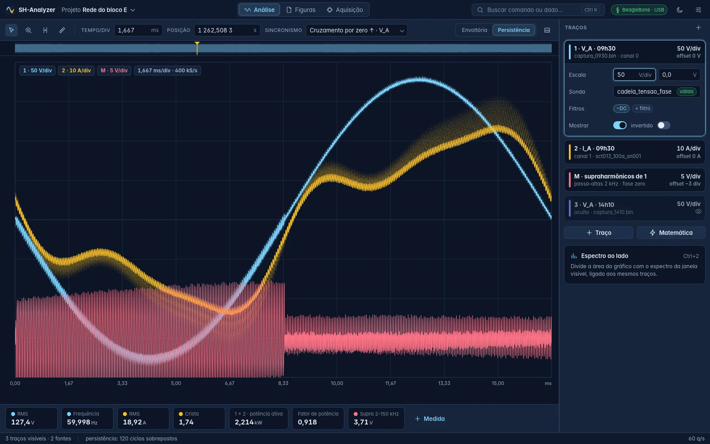
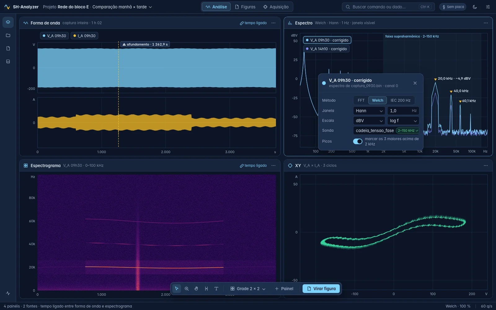
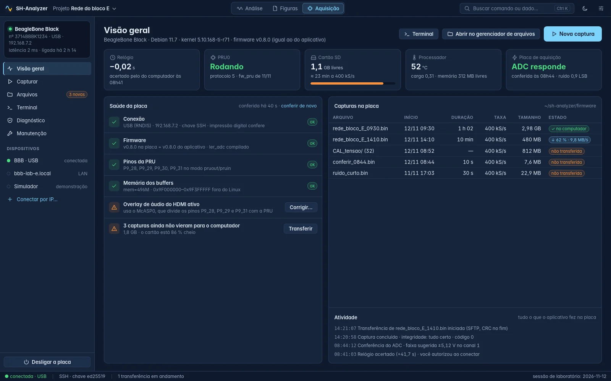
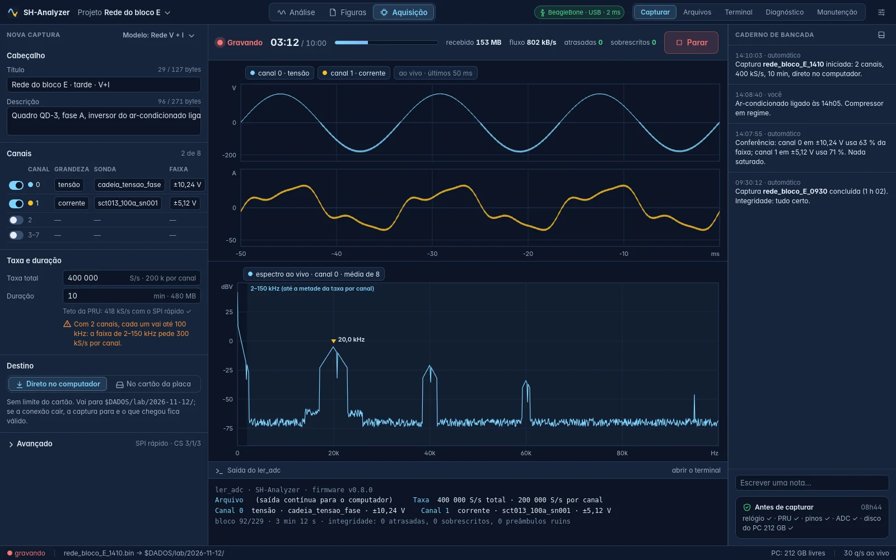
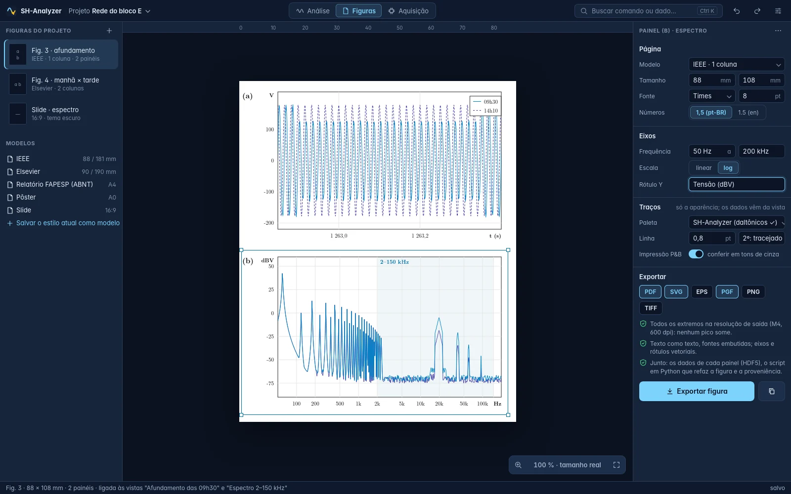

# Plano da interface gráfica do SH-Analyzer

O plano do **SH-Analyzer como aplicativo de desktop**: o lugar onde o pesquisador **analisa** as capturas, **monta figuras** para publicação e **opera a BeagleBone** (conectar, conferir, capturar, trazer os dados e cuidar da placa), sem a linha de comando.

- **Reescrito em 12/11/2026, sobre a v0.8.** Substitui a primeira versão do plano, do mesmo dia.
- **Estado:** planejamento concluído e layout escolhido. Nada da interface foi programado além do esqueleto do pacote `scripts/sh_analyzer_gui/` (janela vazia, ícone e testes).
- **Andamento:** [`docs/gui-progress.md`](gui-progress.md) diz onde o trabalho parou, qual é a próxima tarefa e como retomar depois de uma pausa.
- **Mockups:** [`docs/gui-mockups/index.html`](gui-mockups/index.html), para abrir no navegador; as imagens estão na seção 13.
- **Como ler:**
  - a seção 0 resume as decisões;
  - as seções 5 e 6 justificam as duas decisões que mais pesam (a plataforma e o motor de gráficos);
  - as seções 9 a 11 descrevem as três áreas do aplicativo;
  - a seção 19 lista o que depende de você.

---

## Sumário

0. [Resumo das decisões](#0-resumo-das-decisões)
1. [Visão, usuários e princípios](#1-visão-usuários-e-princípios)
2. [Escopo](#2-escopo)
3. [Requisitos funcionais](#3-requisitos-funcionais)
4. [Requisitos não funcionais](#4-requisitos-não-funcionais)
5. [Decisão 1: a plataforma](#5-decisão-1-a-plataforma)
6. [Decisão 2: o motor de gráficos](#6-decisão-2-o-motor-de-gráficos)
7. [Modelo de dados e transformações](#7-modelo-de-dados-e-transformações)
8. [Arquitetura de software](#8-arquitetura-de-software)
9. [A área de Análise](#9-a-área-de-análise)
10. [A área de Figuras e a exportação](#10-a-área-de-figuras-e-a-exportação)
11. [A área de Aquisição (BeagleBone)](#11-a-área-de-aquisição-beaglebone)
12. [Sistema de design](#12-sistema-de-design)
13. [Layouts propostos](#13-layouts-propostos)
14. [Qualidade e testes](#14-qualidade-e-testes)
15. [Distribuição e licenças](#15-distribuição-e-licenças)
16. [Roteiro por fases](#16-roteiro-por-fases)
17. [Fluxo de trabalho no Git](#17-fluxo-de-trabalho-no-git)
18. [Riscos](#18-riscos)
19. [Decisões em aberto](#19-decisões-em-aberto)
20. [Referências](#20-referências)

---

## 0. Resumo das decisões

| Tema | Decisão | Por quê, em uma linha | Seção |
|---|---|---|---|
| Plataforma | **Python + Qt 6 (PySide6) + Qt Widgets**, com um sistema de design próprio | Reaproveita o motor `supraharmonicos` sem nenhuma ponte; é o que mais rende para uma pessoa; a beleza vem do sistema de design, não do toolkit | 5 |
| Motor de gráficos | **Próprio, em duas camadas:** dados (pirâmide mín/máx M4, em disco) e desenho (um item próprio sobre o PyQtGraph) | Medido: o gargalo não é a biblioteca, é desenhar a banda densa. A pirâmide responde em 0,12 ms, e a banda vira **uma linha vertical de 1 px por coluna**: 8 faixas a p95 de 16 ms no protótipo, e nenhum zoom trava (o polígono chegava a 16 s num quadro) | 6 |
| Matplotlib | **Só na exportação** de figuras, nunca no gráfico interativo | 10 M pontos levam 1,5 s por quadro (0,7 q/s); para PDF, SVG e PGF ele é imbatível | 6, 10 |
| Fidelidade | **Nenhum extremo some.** A tela e a exportação usam a agregação M4 na resolução de saída; os dados exportados são as amostras originais | É o que um artigo exige; M4 desenha igual a todos os pontos naquela resolução | 6.5, 10.3 |
| Transformações | **Receitas por traço**, sem tocar na fonte: escala, filtros, correção de sonda, matemática entre traços. Prévia imediata da janela visível; o resto, em segundo plano, com cache | Interação em tempo real com arquivos de gigabytes | 7 |
| BeagleBone | **SSH (asyncssh)** + um **agente** na placa que responde em JSON + um **simulador** | Nada novo para instalar nem porta para abrir; respostas estruturadas e testáveis; desenvolver e demonstrar sem placa | 11 |
| Capturas longas | **Saída contínua do `ler_adc` direto para o computador** (mudança no firmware) | O cartão da placa limita a duração; pela rede, não | 11.6 |
| Layout | **Escolhido em 12/11/2026: tudo unificado.** O A1 (Estúdio) é a estrutura, com o modo Instrumento (A2) e a grade de vistas (A3) dentro dele; o B1 (Painel com seções), com o B2 como a seção "Capturar"; o F1 para as figuras | Três colunas com o inspetor sempre à vista, para editar cada traço, sem perder o que as outras amostras tinham de bom | 13 |
| Aparência | **Tema escuro com o azul-marinho do ícone e tema claro**; 6 cores de traço conferidas para daltonismo | Identidade da marca e acessibilidade medida, não estimada | 12 |
| Versões | **v0.9** Análise; **v0.10** Aquisição; **v0.11** Figuras; **v1.0** manutenção da placa e acabamento | Primeiro o coração (os gráficos), que tem mais risco | 16 |

---

## 1. Visão, usuários e princípios

### 1.1 A visão

**Um instrumento de laboratório no computador.** O SH-Analyzer tem duas metades de mesmo peso:

- a **análise**: abrir capturas de horas, ver, medir, comparar e transformar cada traço, e transformar isso em figuras de publicação;
- a **aquisição**: falar com a BeagleBone por USB ou pela rede, conferir que a placa está pronta, capturar direto para o computador e cuidar dela (firmware, pinos, relógio).

O aplicativo tem de ser **bonito, moderno e fluido**, e isso vira critério verificável:

| Qualidade | O que significa aqui | Como se confere |
|---|---|---|
| **Fluido** | Zoom e pan a 60 quadros por segundo com 8 traços de uma captura de 1 h; nenhum clique espera um cálculo | Testes de desempenho (seção 14) e um vigia da thread da interface |
| **Fiel** | O que se vê e o que se exporta são os dados; nenhum pico some; cada número diz de onde veio | Testes de fidelidade da exportação e de paridade com a CLI |
| **Bonito e moderno** | Um sistema de design próprio, com cores medidas, tipografia, espaço e movimento, nos temas claro e escuro | A galeria de componentes e a revisão das telas nos dois temas |
| **Seguro na placa** | Nada destrutivo sem confirmação; todo arquivo de configuração tem cópia antes de mudar; tudo o que o aplicativo faz na placa fica registrado | Testes do agente com um sistema de arquivos falso; o registro de atividade |

### 1.2 Quem usa e para quê

| Perfil | O que faz | A jornada que tem de ser curta |
|---|---|---|
| **Pesquisador** | Analisa capturas de campo e de laboratório, publica | Abrir a captura → achar o evento → espectro de 2 a 150 kHz → figura IEEE → PDF e o pacote reproduzível |
| **Estudante na bancada** | Prepara a placa, captura, calibra sondas | Conectar → diagnóstico verde → capturar 1 h direto no computador → abrir no fim |
| **Orientador ou revisor** | Confere resultados | Abrir o projeto → comparar duas capturas → ver a proveniência de cada número |
| **Quem chega ao projeto** | Aprende sem placa | Abrir o simulador → seguir a primeira execução guiada |

**Metas:**

- cada jornada em até **5 ações** a partir da tela inicial, sem ler o manual;
- uma placa recém-gravada fica **pronta para capturar em menos de 10 minutos**, sem terminal: pinos, overlays, firmware e relógio.

### 1.3 Princípios

1. **Os dados são sagrados.**
   - O aplicativo nunca escreve numa captura.
   - Uma transformação é uma receita guardada no projeto, não um arquivo novo.
   - Uma exportação leva as amostras, não o desenho delas.
2. **A tela nunca trava.**
   - A thread da interface tem um orçamento de 8 ms por quadro.
   - Todo o resto roda em segundo plano, com progresso e cancelamento.
   - Vale sempre o pedido mais recente.
3. **Tudo se desfaz:**
   - desfazer e refazer em toda edição;
   - salvamento automático do projeto;
   - cópia de segurança de todo arquivo que o aplicativo muda na placa.
4. **Tudo se reproduz.** Cada figura, tabela e captura leva a proveniência:
   - as fontes, com o CRC;
   - as transformações e as versões;
   - o comando equivalente da CLI.
5. **A verdade fica à vista.** Aparecem na tela, não num log:
   - a integridade da captura;
   - a faixa válida da sonda;
   - a saturação;
   - o aliasing provável;
   - um traço que ainda é prévia.
6. **Um motor só.** A interface chama o pacote `supraharmonicos`. Um número na tela é o número da CLI; nenhum cálculo existe só na GUI.
7. **Funciona sem placa e sem internet.** O simulador substitui a BeagleBone, e nada depende de serviço externo.
8. **Beleza por sistema.**
   - Tokens de cor, tipo, espaço e movimento, aplicados igual em tudo.
   - A cor é dos dados; a moldura recua.

---

## 2. Escopo

**Dentro:**

- as áreas de **Análise**, **Figuras** e **Aquisição**;
- o **Projeto** (fontes, vistas, figuras e notas);
- o **Caderno de bancada**, preenchido sozinho pelas capturas;
- o **simulador** da placa;
- a **exportação** de figuras e dados.

**Fora (não-objetivos):**

- **Monitoramento contínuo**, 24 h por dia, com alarmes. A arquitetura não impede, mas não é o foco.
- **Editar o firmware** dentro do aplicativo. Ele envia, compila e confere; o código se edita no editor.
- **Uma versão web ou na nuvem, e vários usuários no mesmo projeto.**
- **O macOS como plataforma oficial.** O PySide6 roda nele, mas sem teste.
- **Substituir a CLI.** O `adc_tool.py`, o `coletar.sh`, o `BeagleBone_Setup.sh` e o `sessao_lab.sh` continuam, e a GUI segue as mesmas convenções de pasta (`$DADOS/lab/AAAA-MM-DD/`, `anotacoes.md`).

---

## 3. Requisitos funcionais

A prioridade diz em que versão o requisito entra: **v0.9**, **v0.10**, **v0.11**, **v1.0** ou **depois**.

### 3.1 Projeto e dados (PD)

| ID | Requisito | Versão |
|---|---|---|
| PD-01 | Abrir um arquivo ou uma pasta, por diálogo, por arrastar e soltar ou pelos recentes | v0.9 |
| PD-02 | Formatos abertos: `.bin` v1 a v9 (memmap), `.h5` do `adc_tool`, `.csv` do `adc_tool` e o legado sem cabeçalho (pedindo a taxa e os canais) | v0.9 |
| PD-03 | Importar dados de fora: osciloscópio (`.csv`, `.m`, `.mat`, pelo módulo `osciloscopio`), CSV genérico com assistente de colunas e WAV | v0.11 |
| PD-10 | Importar MAT e COMTRADE | depois |
| PD-04 | Abrir os pacotes `.zpaq.tar` (`compactacao`), extraindo para o cache | v1.0 |
| PD-05 | Projeto `.shproj`, com as fontes por caminho relativo, as vistas, os traços, as figuras e as notas; salvamento automático e recuperação depois de uma queda | v0.9 |
| PD-06 | Uma fonte movida de lugar é reencontrada pelo CRC das amostras (v9) ou pelo tamanho e pela data, com a confirmação do usuário | v0.10 |
| PD-07 | Ver o cabeçalho inteiro: os campos por grupo, o CRC do cabeçalho e o das amostras conferidos, copiar como texto ou JSON | v0.9 |
| PD-08 | Ler o `resumo.csv` e o `log.txt` de uma pasta de coleta, mostrando o código de saída e o sinal de cada captura | v0.10 |
| PD-09 | O **caderno de bancada**: notas com hora, e as entradas automáticas de captura, conferência e transferência, no `anotacoes.md` da sessão do dia (o mesmo do `sessao_lab.sh`) | v0.10 |

### 3.2 Gráficos e traços (AN)

| ID | Requisito | Versão |
|---|---|---|
| AN-01 | Plotar qualquer canal de qualquer fonte numa vista: arrastando, com duplo clique ou pelo menu "Plotar em…" | v0.9 |
| AN-02 | Vários traços no mesmo gráfico; adicionar e remover em tempo real, com desfazer | v0.9 |
| AN-03 | Faixas empilhadas com o tempo compartilhado, ou traços sobrepostos; os traços da mesma grandeza dividem o eixo Y por padrão | v0.9 |
| AN-04 | Zoom e pan fluidos, pelo mouse, pelo teclado e pelo trackpad: zoom em caixa, zoom num eixo, histórico de zoom (voltar), ajustar tudo | v0.9 |
| AN-05 | Minimapa da captura inteira, com a janela visível arrastável | v0.9 |
| AN-06 | Modos de desenho: automático (amostras de perto, envoltória de longe), pontos nas amostras de muito perto e densidade ("fósforo", que mostra onde o sinal passa mais) | v0.9 (os dois primeiros), v1.0 (densidade) |
| AN-07 | Selecionar um traço clicando nele, na legenda ou na lista; o inspetor mostra as propriedades; seleção múltipla edita o que é comum | v0.9 |
| AN-08 | O modo **Instrumento**: traços sobrepostos, cada um com escala por divisão e offset, persistência e sincronismo por cruzamento de zero | v1.0 |
| AN-09 | **Vistas em grade** (2 × 2, 1 + 2…) com os eixos ligados entre vistas | v0.11 |
| AN-10 | **Eventos detectados** na captura, numa lista que leva até eles: afundamentos e elevações, picos de supraharmônicos, saturação, descontinuidades, trocas de buffer | v1.0 |
| AN-11 | Anotações na vista (texto, seta, região), salvas no projeto e levadas para a figura | v0.11 |

### 3.3 Transformações por traço (TR)

| ID | Requisito | Versão |
|---|---|---|
| TR-01 | Escala, offset, inversão e deslocamento no tempo, instantâneos em qualquer tamanho de captura | v0.9 |
| TR-02 | Uma **cadeia de etapas** por traço: adicionar, reordenar, ligar ou desligar cada etapa, com a prévia na hora | v0.9 |
| TR-03 | Filtros: passa-baixas, passa-altas, passa-faixa e rejeita-faixa (Butterworth, Chebyshev, elíptico, FIR por janela), em fase zero ou causais; remover o DC; notch dos harmônicos | v0.9 |
| TR-04 | **Correção pelo perfil da sonda** (o mesmo `aplicar_correcao_sonda` da CLI): automática pelo cabeçalho, ou escolhida à mão; a faixa válida aparece no gráfico | v0.9 |
| TR-05 | Matemática entre traços: A − B, A × B (potência instantânea), A / B e uma expressão livre segura (sem `eval` de Python) | v1.0 |
| TR-06 | Reamostrar, derivar e integrar; RMS móvel, envoltória (Hilbert) e frequência instantânea | v1.0 |
| TR-07 | **Alinhar** traços: correlação cruzada, cruzamento por zero, ou arrastando com Alt | v0.11 |
| TR-08 | Um traço transformado vira uma "fonte derivada", que pode ser exportada ou plotada de novo | v0.11 |

### 3.4 Medidas e cursores (ME)

| ID | Requisito | Versão |
|---|---|---|
| ME-01 | Dois cursores verticais e dois horizontais, com Δt, 1/Δt e Δy por traço; mover amostra a amostra pelo teclado | v0.9 |
| ME-02 | Medidas na região ou na janela visível: média, RMS, pico, pico a pico, crista, f₁, THD, RMS da faixa de 2 a 150 kHz, energia | v0.9 |
| ME-03 | Medidas entre traços: potência ativa, fator de potência, defasagem (V × I) | v1.0 |
| ME-04 | A tabela de medidas copia para a planilha e exporta em CSV | v0.9 |
| ME-05 | As métricas de bancada do `medir_captura` (ruído, SNR, SINAD, ENOB, SFDR, jitter) em cartões | v1.0 |

### 3.5 Frequência e normas (ES)

| ID | Requisito | Versão |
|---|---|---|
| ES-01 | Espectro FFT e Welch: janela, resolução, escala (dBV, dBc, V RMS), frequência linear ou logarítmica; a faixa de 2 a 150 kHz sombreada | v0.9 |
| ES-02 | Picos marcados (os N maiores, acima de um limiar), harmônicos de f₁ marcados, piso de ruído | v0.9 |
| ES-03 | Bandas de 200 Hz (IEC 61000-4-7, anexo B, e a extensão usual acima de 9 kHz), em tabela e no tempo (mapa de calor banda × tempo) | v0.9 |
| ES-04 | Espectrograma com mapa de cores perceptual, ligado ao tempo da forma de onda | v0.9 |
| ES-05 | Harmônicos (grupos e subgrupos da IEC 61000-4-7, THD, THDG, THDS), em barras e tabela | v0.9 |
| ES-06 | Aviso de imagem provável acima da faixa válida, e o assistente de aliasing com 2 ou 3 taxas (`aliasing`) | v1.0 |
| ES-07 | Perfis de sonda: lista, Bode (magnitude e fase com barras de erro e a faixa válida), qual perfil cada canal usa e por quê | v0.11 |
| ES-08 | Os assistentes de calibração (a cadeia por ondas quadradas, a razão de dois canais) | depois |

### 3.6 Figuras e exportação (FG)

| ID | Requisito | Versão |
|---|---|---|
| FG-01 | Uma vista vira figura com um clique, e a figura continua ligada à vista | v0.11 |
| FG-02 | Modelos de página (IEEE de 1 e 2 colunas, Elsevier, relatório ABNT, slide, pôster) e modelos de estilo próprios | v0.11 |
| FG-03 | Painéis em grade com rótulos (a), (b)…, eixos compartilhados, ampliação inserida (*inset*) e anotações | v0.11 |
| FG-04 | Editar tudo o que se vê: fontes e tamanhos em pt, espessuras, cores, tracejados, marcadores, legenda, limites, rótulos e unidades | v0.11 |
| FG-05 | Prévia em tons de cinza e com simulação de daltonismo | v0.11 |
| FG-06 | Exportar a figura em PDF, SVG, EPS, PGF, PNG e TIFF, com a fidelidade da seção 10.3 | v0.11 |
| FG-07 | Exportar os dados em CSV, HDF5, MAT e NPZ: a janela, a região ou a captura inteira, crus ou em unidades, com ou sem transformações, sempre com a proveniência | v0.11 |
| FG-10 | Exportar os dados em WAV, Parquet e COMTRADE | depois |
| FG-08 | O **pacote reproduzível** (`.zip`): a figura, os dados de cada painel, um script em Python que refaz a figura e a proveniência | v0.11 |
| FG-09 | Copiar a figura para a área de transferência (PNG e SVG) | v0.11 |

### 3.7 Aquisição (AQ)

| ID | Requisito | Versão |
|---|---|---|
| AQ-01 | Achar a placa sozinho: no USB (porta serial do gadget e os IPs 192.168.7.2 e 192.168.6.2) e na rede local (mDNS, `beaglebone.local`) | v0.10 |
| AQ-02 | Conectar por IP ou nome, com porta e salto (*ProxyJump*), para a LAN e a WAN; placas salvas | v0.10 |
| AQ-03 | Primeira conexão segura: confirmar a impressão digital da chave do host, instalar uma chave SSH do aplicativo, sugerir trocar a senha padrão | v0.10 |
| AQ-04 | Visão geral: o modelo, o nº de série, o sistema, o kernel, o firmware, o tempo ligada, a temperatura, a carga, o disco e o relógio | v0.10 |
| AQ-05 | **Diagnóstico** com um botão "Corrigir" em cada item corrigível (seção 11.9) | v0.10 (ver), v1.0 (corrigir) |
| AQ-06 | **Arquivos:** navegar pela placa, transferir com fila e retomada, conferir o CRC, apagar só o que já foi conferido no computador, abrir direto na Análise | v0.10 |
| AQ-07 | Abrir a pasta da placa no **gerenciador de arquivos do sistema** (SFTP pelo GVfs ou sshfs no Linux; SSHFS-Win no Windows, se instalado) | v0.10 |
| AQ-08 | **Terminal** embutido (SSH com PTY), com abas, busca, gravação na pasta da sessão e atalhos de comandos; e abrir no terminal do sistema | v0.10 |
| AQ-09 | Console pela **porta serial do USB** quando a rede da placa não sobe (resgate) | v1.0 |
| AQ-10 | **Capturar:** o formulário do cabeçalho e dos canais, validado ao vivo; modelos de captura; destino no computador ou no cartão | v0.10 |
| AQ-11 | **Ao vivo** durante a captura: o sinal, o espectro e os contadores de integridade; parar com segurança | v0.10 |
| AQ-12 | **Saída contínua** direto para o computador, sem o limite do cartão (seção 11.6) | v0.10 |
| AQ-13 | As rotinas do `coletar.sh` (conferir, calibrar, sonda, aliasing, ruído, teto, bancada): primeiro pelo terminal, com o comando pronto; depois por formulários | v0.10 (terminal), depois (formulários) |
| AQ-14 | Acertar o relógio da placa pelo do computador (ela não tem bateria de RTC), com a sua permissão lembrada | v0.10 |
| AQ-15 | **Atualizar o firmware** (o `firmware/` da versão do aplicativo): enviar, compilar, carregar na PRU, conferir e voltar à versão anterior se algo falhar | v1.0 |
| AQ-16 | **Assistente de pinos e overlays:** conferir e corrigir o `/boot/uEnv.txt` (áudio do HDMI, PRU, `mem=496M`) com diff, cópia de segurança e reinício guiado | v1.0 |
| AQ-17 | Sistema: reiniciar, desligar com segurança, logs filtrados (`dmesg`, `journalctl`), espaço em disco, expandir a partição | v1.0 |
| AQ-18 | **Registro de atividade:** cada comando que o aplicativo rodou na placa, com hora e código de saída | v0.10 |
| AQ-19 | **Simulador** da placa, com cenários (rede de 60 Hz, ADC mudo, disco cheio, conexão que cai, firmware antigo) | v0.10 |

### 3.8 Geral (GE)

| ID | Requisito | Versão |
|---|---|---|
| GE-01 | **Paleta de comandos** (Ctrl+K): qualquer ação, captura, traço ou configuração pelo nome | v0.9 |
| GE-02 | Atalhos de teclado para tudo o que é frequente, com a lista em Ajuda | v0.9 |
| GE-03 | Desfazer e refazer em toda edição (`QUndoStack`) | v0.9 |
| GE-04 | Temas escuro, claro e "o do sistema"; troca sem reiniciar | v0.9 |
| GE-05 | Configurações: pastas (`$DADOS`, sondas, cache), unidades, separador decimal, reduzir movimento, densidade da interface, limite do cache | v0.9 |
| GE-06 | Interface em português; inglês na v1.0 | v0.9, v1.0 |
| GE-07 | Primeira execução guiada (com o simulador) e estados vazios que dizem o próximo passo | v1.0 |
| GE-08 | Ajuda contextual: o "?" de cada painel abre a seção do `user-guide.md` | v1.0 |
| GE-09 | Um erro inesperado abre um diálogo com os detalhes copiáveis e o caminho do log, sem fechar o aplicativo | v0.9 |

---

## 4. Requisitos não funcionais

### 4.1 Desempenho

Medido num notebook de laboratório comum (4 núcleos, 8 GB, SSD, sem placa de vídeo dedicada), no Windows e no Linux. A referência é a captura de **1 h a 400 kS/s com 2 canais**: 1,44 bilhão de amostras e 2,9 GB.

| Situação | Meta |
|---|---|
| Abrir o aplicativo até a janela | < 1,5 s |
| Abrir a captura de 1 h até ver a forma de onda | < 1 s com a pirâmide no cache; < 8 s na primeira vez, com a envoltória aparecendo aos poucos desde o primeiro segundo |
| Pan e zoom com 8 traços | ≥ 60 q/s (quadro ≤ 16 ms no p95) |
| Mudar uma propriedade visual (cor, espessura, escala) | < 50 ms |
| Mudar um filtro | Prévia da janela visível em < 200 ms; a captura inteira em segundo plano, com progresso no chip do traço |
| Espectro de Welch da captura inteira | Em blocos, com memória constante e progresso; < 15 s |
| Thread da interface | Nenhum bloqueio > 50 ms; o vigia do modo de desenvolvimento registra os de > 16 ms |
| Memória | < 1,5 GB, qualquer que seja o tamanho da captura; nunca a captura inteira em `float64` |
| Transferir da placa | Limitada pelo SSH da placa (~10 MB/s esperados no USB); a interface nunca trava durante a transferência |
| Saída contínua a 400 kS/s | 800 kB/s sustentados, sem perder amostra, com a prévia ao vivo a 30 q/s |

### 4.2 Confiabilidade

- Salvamento automático do projeto a cada 60 s e em cada mudança estrutural; gravação atômica (arquivo temporário + renomear).
- Depois de uma queda, o projeto e as tarefas abertas voltam.
- Uma captura nunca é aberta para escrita. O cache é descartável: apagado, ele é refeito.
- Uma captura ou transferência na placa sobrevive à queda da conexão, e o aplicativo a reencontra (seção 11.2).

### 4.3 Segurança

- **Chaves do SSH:**
  - chaves `ed25519` geradas pelo aplicativo;
  - a impressão digital do host conferida (TOFU) e fixada;
  - se a chave do host muda, o aplicativo **bloqueia** a conexão e explica, em vez de seguir.
- **Senhas:** só no cofre do sistema (`keyring`: Credential Manager no Windows, Secret Service no Linux), nunca em texto, em log ou na linha de comando.
- **Na WAN:** a recomendação é uma VPN (Tailscale, WireGuard) ou um host de salto; o aplicativo avisa quando a placa responde na internet com a senha padrão.
- **Confirmação explícita** para tudo o que é destrutivo ou difícil de desfazer na placa (apagar, reiniciar, mudar o `uEnv.txt`, atualizar o firmware), com o que vai acontecer escrito no botão.

### 4.4 Portabilidade e acessibilidade

- **Sistemas:**
  - Windows 10 e 11 (x64);
  - Linux x64: Ubuntu 22.04+, Debian 12+, Fedora recente; X11 e Wayland;
  - escalas de tela de 100 % a 200 %.
- **Contraste:** o texto tem ≥ 4,5:1 e os elementos de gráfico, ≥ 3:1, nos dois temas. É conferido por teste (seção 12).
- **Cor e teclado:**
  - nada é dito só por cor (ícone e texto juntos);
  - tudo pode ser feito pelo teclado, com foco visível;
  - "reduzir movimento" é respeitado;
  - a densidade da interface é regulável (compacta e confortável).

---

## 5. Decisão 1: a plataforma

### 5.1 O que pesa

1. O motor de análise **já existe em Python**: são milhares de linhas testadas, com NumPy e SciPy. A interface tem de chamá-lo sem ponte.
2. Os dados são **grandes**: gigabytes em memmap. Copiar entre processos ou linguagens custa caro.
3. É **uma pessoa** desenvolvendo, com idas ao laboratório e um relatório científico.
4. Tem de ser **bonito e moderno**, no Windows e no Linux.
5. A exportação científica (PDF, SVG, PGF) é melhor no ecossistema Python (Matplotlib).

### 5.2 As opções

Notas de 1 (ruim) a 5 (ótimo). O peso vem da seção 5.1.

| Critério (peso) | **PySide6 + Qt Widgets** | PySide6 + Qt Quick (QML) | Tauri ou Electron + web + Python ao lado | Dear PyGui (ImGui) | Flutter ou Avalonia + Python ao lado |
|---|---|---|---|---|---|
| Reuso do motor Python (5) | **5** | 4 | 2 | 5 | 2 |
| Dados grandes sem cópia (5) | **5** | 4 | 2 | 4 | 2 |
| Beleza e modernidade possíveis (4) | 4 (com sistema de design) | **5** | **5** | 2 | **5** |
| Animações e fluidez (3) | 3 | **5** | **5** | 4 | **5** |
| Interfaces densas: tabelas, árvores, formulários (4) | **5** | 3 | 4 | 3 | 4 |
| Gráficos científicos interativos (5) | **5** (PyQtGraph) | 2 | 4 (WebGL) | 4 (ImPlot) | 2 |
| Custo para uma pessoa (5) | **5** | 3 | 2 | 4 | 2 |
| Empacotamento (3) | 4 | 4 | 2 | 4 | 2 |
| Maturidade e longevidade (3) | **5** | 4 | 5 | 3 | 4 |
| **Total ponderado** | **171** | 141 | 127 | 135 | 121 |

### 5.3 A decisão: PySide6 com Qt Widgets e um sistema de design próprio

- **PySide6** (Qt 6, LGPLv3), não o PyQt6 (GPL), que obrigaria a GUI a ser GPL. A versão mínima é a **6.8** (LTS).
- **Qt Widgets** com o estilo Fusion de base e a aparência inteira vinda dos tokens (seção 12):
  - `QPalette` e uma folha QSS geradas dos tokens;
  - os componentes que fazem a cara do aplicativo pintados com `QPainter`: chips, seletores segmentados, chaves, cartões, cursores e legenda;
  - fontes embutidas e ícones SVG recoloridos.

  É assim que aplicativos Qt modernos fogem do "visual de Windows 95".
- **A moldura da janela é a do sistema.** A barra superior dos mockups é uma barra de ferramentas embaixo dela: assim o Windows continua encaixando a janela nas bordas, o Wayland desenha a moldura e a acessibilidade não quebra.
- **Animações** com `QVariantAnimation` e `QPropertyAnimation`, na medida da seção 12.7: painéis, transições de aba, toasts e zoom programado.

### 5.4 Por que não as outras

- **Qt Quick (QML).** É o mais bonito e fluido do Qt, mas pede:
  - uma segunda linguagem;
  - modelos de dados atravessando a fronteira Python → QML a cada mudança;
  - o gráfico como `QQuickItem` próprio (o Qt Graphs 2D foi pensado para painéis de indicadores, não para dezenas de milhões de pontos).

  Fica a porta aberta para usar QML numa tela pontual, como a primeira execução.
- **Web (Tauri ou Electron).** Tem a interface mais fácil de deixar bonita, mas:
  - são duas linguagens e dois processos;
  - os dados atravessam um IPC a cada zoom;
  - é preciso empacotar o Python ao lado de um navegador;
  - o desenho interativo (WebGL) e a exportação (Matplotlib) ficariam em linguagens diferentes, com dois desenhos para manter iguais.

  Para uma pessoa, o custo dobra.
- **Dear PyGui.** O ImPlot é rápido, mas a aparência é de ferramenta de depuração, e textos, formulários e acessibilidade são fracos.
- **Flutter ou Avalonia.** São bonitos, mas têm as mesmas pontes da opção web, com um ecossistema científico menor.

---

## 6. Decisão 2: o motor de gráficos

O gráfico interativo é o coração do aplicativo. Esta decisão foi tomada com medidas, não com opinião.

### 6.1 O problema em números

- **A captura:** 1 h a 400 kS/s com 2 canais tem **720 milhões de amostras por canal**.
- **A tela:** um gráfico tem ~1 600 colunas de pixel. Com a captura inteira à vista, cada coluna representa **450 000 amostras**.
- **A conclusão:** nenhuma biblioteca desenha isso "mais rápido". A pergunta certa é **como reduzir sem mentir**, e a resposta tem de valer em qualquer zoom, da captura inteira até a amostra.

Um sinal de 60 Hz visto de longe é uma **banda sólida**: em cada coluna, ele vai do mínimo ao máximo. Esse é o caso comum na rede elétrica, e foi o que as medidas mostraram ser o caro.

### 6.2 As medidas

Feitas em 12/11/2026 com `scripts/benchmarks/plotagem_gui.py`, num Intel i7-7700HQ de 2017, desenhando na CPU (QPainter raster, sem tela). A área é de 1 600 × 900 px, e o sinal sintético tem 100 M amostras de 16 bits, como as capturas.

| O que se mediu | Tempo por quadro |
|---|---|
| **Matplotlib** (Agg), 1 traço de 1 M pontos | 178 ms (5,6 q/s) |
| **Matplotlib**, 1 traço de 10 M pontos | 1 456 ms (0,7 q/s) |
| **Matplotlib**, 8 traços já reduzidos (3 200 pontos cada, a banda cheia) | 2 010 ms |
| **PyQtGraph**, 1 traço de 1 M pontos crus | 74 ms |
| **PyQtGraph**, 1 traço de 10 M pontos com a redução dele (`peak`) | 35 ms, com os 10 M na RAM e a redução refeita a cada quadro |
| **Pirâmide mín/máx:** construção | 308 M amostras/s: ~2,3 s por canal de 1 h |
| **Pirâmide:** consulta de qualquer janela → 1 600 colunas | **0,12 ms**, em qualquer zoom |
| Pirâmide: espaço extra | 7,1 % do arquivo |
| 8 traços, banda cheia, **linha de 1 px**, sem antialiasing | 67 ms |
| 8 traços, banda cheia, linha de 1 px, com antialiasing | 156 ms |
| 8 traços, banda cheia, linha de 1,5 px, sem antialiasing | 280 ms |
| 8 traços, banda cheia, linha de 1,5 px, com antialiasing | **100 s** |
| 8 traços, banda cheia, **polígono preenchido** (com antialiasing) | **11,7 ms** |
| 8 traços, ciclos visíveis (100 ms), linha de 1 px com antialiasing | 7,8 ms |
| 8 traços, ciclos visíveis, linha de 1,5 px com antialiasing | 460 ms |
| 8 traços, ciclos visíveis, polígono | 9,6 ms |

**A segunda rodada (13/11/2026), já com o `TracoLOD`** (`plotagem_gui.py colunas` e o protótipo `prototipos/navegar.py --medir`), mostrou o que a primeira não via:

| O que se mediu | Polígono preenchido | Uma linha vertical de 1 px por coluna |
|---|---|---|
| 8 traços sobrepostos, banda cheia (a captura inteira) | 6,3 ms | 29,3 ms |
| 8 traços sobrepostos, **banda oscilante** (cada coluna cobre meio ciclo de 60 Hz) | **16 366 ms** | 19,0 ms |
| 8 traços sobrepostos, ciclos visíveis | 4,4 ms | 3,2 ms |
| Protótipo, 2 faixas, zoom e pan da captura inteira até 50 amostras (p95) | 150 ms | **10,2 ms** |
| Protótipo, 8 faixas, o mesmo percurso (p95) | — | **16,0 ms** (os traços: ~1,5 ms; o resto: os eixos do PyQtGraph) |

**O que as medidas dizem** (as duas rodadas):

1. **O Matplotlib não serve para o gráfico interativo.** Mesmo com os dados já reduzidos, ele redesenha a figura inteira na CPU: 2 s por quadro na banda cheia.
2. **A redução tem de vir de uma pirâmide pronta.** Reduzir a cada quadro, como o PyQtGraph faz, exige a captura na memória e custa O(N). A pirâmide responde em tempo constante, em qualquer zoom.
3. **Desenhar a banda como linha em zigue-zague é o erro clássico,** e espessura > 1 px com antialiasing é desastrosa no QPainter (100 s).
4. **O polígono preenchido é rápido na banda lisa, mas imprevisível.** Na banda oscilante, em que as colunas vizinhas alternam entre o topo e a base, ele vira centenas de arestas longas e chega a 16 s num quadro: a tela trava.
5. **Uma linha vertical de 1 px por coluna de pixel** (o desenho dos osciloscópios digitais) custa proporcional à área pintada, nunca trava, e cada coluna pinta exatamente o seu pixel: um pico aparece inteiro, na coluna dele. **É o desenho escolhido.** O caso mais pesado medido, 8 traços altos sobrepostos, fica acima de 16 ms; se as medidas em tela de verdade (os portões G1 e G2) pedirem, um desenho híbrido (o polígono quando a banda é lisa) é a otimização seguinte.
6. **De perto (ciclos visíveis), linhas de 1 px com antialiasing são baratas** (7,8 ms para 8 traços). Linhas grossas, só com a GPU.
7. **Os acessórios do PyQtGraph pesam mais que os traços:** a grade semitransparente custava ~17 ms por quadro e os rótulos com prefixo do SI refaziam o HTML a cada quadro. A grade e os eixos próprios, opacos e com o texto em cache, vêm com o tema e a vista de tempo.

### 6.3 As opções avaliadas

| Opção | O que é | Veredito |
|---|---|---|
| **Matplotlib interativo** (QtAgg) | O padrão científico | **Não**, para o interativo (6.2). **Sim**, para a exportação |
| **PyQtGraph puro** | Gráficos Qt rápidos (MIT); a 0.14 (nov/2025) passou a usar OpenGL moderno | Sozinho, **não**: ele reduz a cada quadro e desenha a banda como linha. Como **base** (eixos, `ViewBox`, interação, ROI, ligação entre vistas, exportação da cena), **sim** |
| **VisPy** | OpenGL, maduro e rápido | Eixos, texto e interação ficam por conta própria, e o ritmo de desenvolvimento é menor. **Não**, por ora |
| **fastplotlib e pygfx** | GPU moderna (WGPU) | Promissores e rápidos, mas novos, com a API mudando e as versões presas ao rendercanvas e ao wgpu. **É o plano B da GPU** (6.7) |
| **Plotly com plotly-resampler, uPlot** | Web, com WebGL | Pedem o navegador (decisão 1). **Não** |
| **Qt Graphs / Qt Charts** | Gráficos do próprio Qt | Feitos para painéis de indicadores; o Qt Charts está sendo substituído. **Não** |
| **Uma biblioteca de gráficos inteira própria** | Eixos, texto, interação, exportação | Anos de trabalho para refazer o que o PyQtGraph e o Matplotlib já têm. **Não** |
| **Motor próprio de dados + item de desenho próprio sobre o PyQtGraph** | A redução e o desenho do traço são nossos; o resto é do PyQtGraph | **Sim** |

### 6.4 A decisão: o motor em duas camadas

```text
 captura .bin/.h5 (memmap, só leitura)
        │
        ▼
 ┌─────────────────────────────── camada de DADOS (sem Qt, testável) ───────────────────────────────┐
 │  Pirâmide mín/máx por canal (níveis de 32, 256, 2 048… amostras), em disco no cache             │
 │  Cadeia de transformações do traço (seção 7): as lineares agem na pirâmide; as outras são        │
 │  materializadas em segundo plano, com a prévia da janela visível                                │
 │  consulta(janela, colunas) → por coluna: mín, máx, primeiro, último (M4)    → 0,12 ms           │
 └──────────────────────────────────────────────────┬───────────────────────────────────────────────┘
                                                    │ ~1 600 colunas por traço
                                                    ▼
 ┌─────────────────────────────── camada de DESENHO (Qt) ───────────────────────────────────────────┐
 │  TracoLOD: um QGraphicsObject próprio dentro do PlotItem do PyQtGraph                            │
 │    • de perto (≤ 2 amostras por coluna): linha das amostras, 1 px com antialiasing;             │
 │      pontos nas amostras a partir de ~8 px por amostra                                           │
 │    • de longe: uma linha vertical de 1 px por coluna de pixel, do mín ao máx dela (sem           │
 │      antialiasing; colunas vizinhas ligadas nos degraus; altura mínima de 1 px)                  │
 │    • densidade (v1.0): histograma por coluna → imagem com o mapa de cores do tema                │
 │  Eixos, grade, ViewBox, cursores, ROI, legenda: PyQtGraph, com o tema                           │
 └──────────────────────────────────────────────────────────────────────────────────────────────────┘
        │ a mesma consulta, na resolução de saída
        ▼
 Exportação: Matplotlib (PDF, SVG, EPS, PGF, PNG, TIFF), a partir do modelo da figura (seção 10)
```

**A pirâmide:**

- **Os níveis:** o nível 0 guarda o mín e o máx de cada bloco de 32 amostras, em `int16`, como a captura. Cada nível seguinte agrupa 8 blocos do anterior. São 7 níveis para 100 M amostras, com 7,1 % de espaço extra.
- **Onde fica:** num arquivo do cache (`platformdirs.user_cache_dir`), com a chave no CRC das amostras do cabeçalho v9 (ou no tamanho e na data nas versões anteriores). Abrir de novo é instantâneo.
- **Como é construída:**
  - em segundo plano, primeiro o nível mais grosso, para a envoltória aparecer no primeiro segundo e ganhar detalhe;
  - em blocos sobre o memmap, sem carregar a captura;
  - num processo à parte, se o perfil mostrar disputa pelo GIL.
- **A consulta:**
  - escolhe o nível com ~2 blocos por coluna;
  - reduz com `np.minimum.reduceat` e `np.maximum.reduceat`;
  - devolve também a primeira e a última amostra de cada coluna (M4), para que a linha ligue as colunas exatamente como ligaria com todos os pontos;
  - de perto, lê as amostras de verdade direto do memmap.

**Por que isso é o "motor próprio" certo:**

- a parte específica dos nossos dados (a redução, as transformações, o cache) é nossa e não depende do Qt;
- a parte genérica (eixos, texto, interação, exportação vetorial) vem de bibliotecas maduras;
- o item de desenho tem uma interface pequena. Se a GPU for necessária, troca-se o item, não o aplicativo.

### 6.5 Regras de fidelidade

1. **Nenhum extremo some.** Em qualquer zoom, cada coluna mostra o mínimo e o máximo **exatos** das amostras que ela cobre. A pirâmide é exata, não uma estimativa. O LTTB e a subamostragem, que podem esconder picos, ficam proibidos.
   - Para não ler amostras cruas a cada quadro, a consulta arredonda as bordas das colunas para blocos da pirâmide: com ≥ 8 blocos por coluna, a largura varia no máximo 1/8 de pixel.
   - Por isso, um pico a menos de um bloco da borda de um pixel aparece no pixel ao lado: **a posição vale com ±1 px**, e o pico aparece inteiro.
2. **De perto, o que se vê são as amostras.** A partir de ~8 px por amostra, os pontos aparecem.
3. **A prévia se diz prévia.** Um traço com uma transformação ainda não materializada mostra o chip com a porcentagem e um contorno tracejado. As medidas sobre ele dizem "prévia".
4. **As medidas usam as amostras, nunca o desenho.** O RMS de uma região é calculado sobre os dados (ou o traço materializado) daquela região.
5. **A exportação refaz a redução na resolução de saída** (seção 10.3), e os dados exportados são as amostras.

### 6.6 Fluidez: como cada quadro é feito

- **O orçamento de um quadro de pan ou zoom,** medido no protótipo com 8 faixas numa CPU de 2017:
  - consultas à pirâmide e montagem das linhas: 8 × ~0,5 ms;
  - pintura dos traços: ~1,5 ms;
  - o resto, até ~13 ms de mediana: os eixos e as caixas de vista do PyQtGraph.
- **Um quadro por vez:** a mudança da vista só agenda o recálculo (um `QTimer` de intervalo 0). Várias mudanças no mesmo ciclo de eventos viram uma consulta só, e o Qt junta as pinturas.
- **Disco frio:** se a consulta tocar páginas que ainda não estão na memória, ela vai para uma thread. Enquanto isso, a tela mostra o nível mais grosso esticado e refina quando a resposta chega, como os mapas na internet.
- **Rolagem do mouse:** o zoom é contínuo, centrado no cursor. O trackpad faz pan e zoom com o gesto do sistema.
- **Animação só em saltos programados** ("ir para o evento", "ajustar"), com uma transição de 200 ms. Nunca sob a mão do usuário.
- **A seleção não engrossa a linha** (linha grossa é cara, 6.2). O traço selecionado fica por cima e na cor plena, e os outros perdem um pouco de opacidade.

### 6.7 Os portões da Fase 0 e o plano B

O protótipo (`interface/piramide`) tem de passar nestes portões, no Windows e no Linux, num notebook comum, antes de qualquer tela ser construída sobre ele:

| Portão | Critério |
|---|---|
| G1 | Captura sintética de 1 h, 2 canais, 400 kS/s: pan e zoom com 8 traços a ≥ 60 q/s (p95 ≤ 16 ms), da captura inteira até a amostra. **Aprovado em 13/11/2026** na tela do usuário: 8 faixas, p95 de 14,4 ms |
| G2 | A mesma coisa em tela de 4K com escala de 200 % (o custo da pintura cresce com os pixels). **A medir** |
| G3 | A pirâmide do arquivo de 2,9 GB em < 8 s, com memória < 500 MB. **Aprovado pela taxa** (≥ 200 M amostras/s, ~5 s para o arquivo); a memória ainda não foi medida |
| G4 | Fidelidade (`tests/test_gui_traco_lod.py`): em cada coluna de pixel, o mínimo e o máximo das amostras aparecem pintados por inteiro (nela ou numa vizinha), nada passa do que as vizinhas têm, e as colunas estão nos seus pixels. **Aprovado** |
| G5 | Sem travar com o disco frio (a primeira abertura depois de reiniciar o computador). **A medir** |

**Plano B, se G1 ou G2 falharem:**

1. o item `TracoLOD` desenha com o **OpenGL moderno do PyQtGraph 0.14** (linhas grossas e antialiasing na GPU);
2. se não bastar, um `TracoLOD` sobre o **pygfx**, num `QWidget` próprio.

Em ambos, a camada de dados e o resto do aplicativo não mudam.

---

## 7. Modelo de dados e transformações

### 7.1 Os conceitos

```text
Projeto (.shproj)
 ├── Fontes ─────────── captura .bin/.h5/.csv, importação (osciloscópio, WAV…), fonte derivada
 │     └── Canais ───── canal físico: grandeza, sonda, faixa do ADC, taxa (do cabeçalho)
 ├── Vistas ─────────── tipo (tempo, espectro, espectrograma, bandas, harmônicos, XY, histograma…)
 │     ├── Faixas e eixos
 │     ├── Traços ───── canal + cadeia de transformações + estilo
 │     ├── Cursores, regiões, anotações
 │     └── Medidas
 ├── Figuras ────────── página + painéis (cada um ligado a uma vista) + estilo
 ├── Notas ──────────── o caderno de bancada (anotacoes.md da sessão)
 └── Layout ─────────── docks, grade de vistas, abas abertas
```

- **Um traço nunca copia dados.** Ele é uma receita: de qual canal vem, quais transformações, com que estilo.
- **Uma vista é um tipo de gráfico com os seus traços.** O mesmo canal pode estar em várias vistas, com transformações diferentes.
- **O projeto guarda receitas, não resultados.** Os resultados ficam no cache e se refazem quando somem.

### 7.2 A cadeia de transformações

Cada etapa declara como se comporta, e é isso que decide o custo:

| Classe | Exemplos | Como se aplica | Custo de uma mudança |
|---|---|---|---|
| **Afim** | escala, offset, inversão, deslocamento no tempo | **Direto na pirâmide**: mín e máx passam pela conta (com a escala negativa, eles se trocam) | Instantâneo, em qualquer tamanho |
| **Com memória** | filtros, correção de sonda, derivada, integral, reamostragem | Na **janela visível + margem de acomodação**, na hora (a prévia); a captura inteira em segundo plano, em blocos com o estado do filtro levado de um bloco ao outro, gravada no cache com a sua pirâmide | < 200 ms para a prévia; segundos para a captura inteira, sem travar |
| **Entre traços** | A − B, A × B, A / B, expressão | Alinha as taxas (reamostrando o de menor taxa) e materializa como acima | Como a anterior |
| **Agregada** | RMS móvel, envoltória, frequência instantânea, bandas no tempo | Produz uma série de taxa menor, materializada | Como a anterior |

- **A margem:** um filtro precisa das amostras antes e depois da janela. Cada etapa informa a sua acomodação (por exemplo, ~5 constantes de tempo de um IIR). A prévia lê a janela com essa margem e descarta as bordas.
- **Fase zero em blocos:** o `sosfiltfilt` precisa da série inteira de trás para a frente. Em blocos, são duas passadas sobre o arquivo do cache: a direta, com o estado levado adiante, e a reversa. O resultado é **o mesmo** do `sosfiltfilt` sobre o vetor inteiro. Um teste confere isso, com tolerância de 1e-9 relativo.
- **A correção de sonda** usa o `aplicar_correcao_sonda` do motor. Em blocos, é sobreposição e soma (*overlap-add*) com o mesmo filtro, e um teste confere a paridade com a função original.
- **O cache das materializações** é endereçado pelo conteúdo: o hash da fonte (CRC) + o canal + a receita. Duas vistas com a mesma receita dividem o mesmo arquivo. O cache tem limite de tamanho (LRU) e um botão "limpar".

### 7.3 O arquivo de projeto

- **O formato:** JSON legível, com `"formato": "sh-analyzer-projeto"` e uma versão. Uma versão nova lê as antigas.
- **As fontes:** guardadas pelo caminho **relativo ao projeto** e pelo CRC das amostras. Se o caminho falha, a busca pelo CRC as reencontra (PD-06).
- **O que não vai para o arquivo:** os resultados e o histórico do desfazer.
- **Salvamento automático** num arquivo ao lado (`.shproj~`), que vira o principal ao salvar. Ao abrir, se houver um mais novo, o aplicativo pergunta.

---

## 8. Arquitetura de software

### 8.1 Os pacotes

```text
scripts/
 ├── supraharmonicos/        o motor (sem Qt, sem rede): o que já existe
 │    └── api.py             a fachada sem argparse (seção 8.2)
 ├── sh_analyzer_gui/        o aplicativo (Qt)
 │    ├── dados/             SEM Qt: pirâmide, consulta M4, cadeia de transformações, cache, projeto
 │    ├── modelo/            o estado observável (projeto, vistas, traços, seleção) e os comandos de desfazer
 │    ├── servicos/          tarefas em segundo plano, cache, placa (ponte para o sh_placa)
 │    ├── graficos/          TracoLOD, eixos e cursores com o tema, vistas (tempo, espectro…)
 │    ├── areas/             analise/, figuras/, aquisicao/: as telas
 │    ├── componentes/       chips, segmentado, chave, cartão, inspetor, paleta de comandos, toast
 │    ├── tema/              tokens → QPalette + QSS, fontes, ícones
 │    └── recursos/          SVG, fontes, traduções
 ├── sh_placa/               a BeagleBone, SEM Qt: descoberta, SSH, agente, SFTP, saída contínua, simulador
 └── benchmarks/             as medidas que sustentam as decisões (seção 6.2)
firmware/
 └── agente/shan_agente.py   o agente na placa: só a biblioteca padrão do Python 3
```

**As regras de dependência**, conferidas por teste (`tests/test_arquitetura.py`):

- o motor nunca importa o Qt nem a rede;
- o `sh_analyzer_gui.dados` e o `sh_placa` nunca importam o Qt, e rodam e se testam sem ele;
- a interface só chama o motor pela `api` e nunca monta um `argparse.Namespace`;
- o agente da placa não importa nada de fora da biblioteca padrão (a placa não tem pip).

**Os extras do `pyproject.toml`:**

- **`gui`** = PySide6 e PyQtGraph;
- **`placa`** = asyncssh, zeroconf, pyserial e keyring;
- **`gui-dev`** = os dois, mais o pytest-qt.

### 8.2 A camada `supraharmonicos.api`

O que prende o motor à linha de comando é o `contexto.resolver_contexto(args)` e os `executar_*` do `modos.py`, que recebem o `argparse.Namespace`. A camada nova solta esse nó sem duplicar lógica:

- **`abrir_captura(caminho, *, canais=None, faixas=None, ganhos=None, perfis=None) -> Captura`.** Devolve:
  - o cabeçalho e o memmap;
  - os canais e a calibração resolvida;
  - os avisos estruturados (`Aviso(nivel, codigo, texto, canal)`).

  O `resolver_contexto(args)` passa a chamá-la, e a CLI não muda.
- **`sinal_do_canal(captura, canal, inicio, fim, *, corrigir_sonda=True)`** dá o trecho em unidades físicas.
- **`espectro`, `welch`, `bandas_iec`, `harmonicos`, `espectrograma`, `metricas`:** parâmetros num dataclass imutável, resultado noutro, sobre as funções que já existem.
- **Testes de paridade:** a CLI e a API dão os mesmos números nas capturas sintéticas (`tests/capturas_sinteticas.py`).

### 8.3 As threads

| Onde | O que roda | Como fala com a interface |
|---|---|---|
| Thread da interface | Eventos, pintura, consultas pequenas à pirâmide | — |
| `QThreadPool` | Pirâmides, materializações, espectros, medidas (o NumPy e o SciPy liberam o GIL) | Sinais Qt; um token de cancelamento por tarefa; vale a mais recente |
| Uma thread com laço `asyncio` | Toda a rede: asyncssh, SFTP, saída contínua, mDNS | Sinais Qt (conexões enfileiradas); o `sh_placa` é `async` e não sabe do Qt |
| Processos (só se o perfil pedir) | Contas em Python puro que disputem o GIL | `concurrent.futures`, com os dados em memmap |

O `QtAsyncio` do PySide6 ainda está em prévia técnica, e o `qasync` acopla os dois laços. **Uma thread dedicada ao `asyncio` é o desenho mais simples e robusto.**

### 8.4 Estado, comandos e erros

- **Todo estado editável fica no `modelo/`** (objetos observáveis com sinais).
- **Toda edição é um `QUndoCommand`.** Por isso o desfazer cobre tudo, inclusive adicionar e remover traços e mudar uma etapa da cadeia.
- **Os erros do motor (`ErroSHAN`)** viram uma mensagem no lugar certo (o chip do traço, o painel de avisos), nunca uma janela modal no meio do trabalho.
- **O log** fica na pasta do sistema (`platformdirs.user_log_dir`), em rotação, sem senhas nem conteúdo de arquivos.

---

## 9. A área de Análise

O layout recomendado é o **A1 (Estúdio)**; as alternativas estão na seção 13.

### 9.1 As regiões da tela

| Região | O que tem |
|---|---|
| **Barra superior** | A marca, o projeto, as três áreas (Análise, Figuras, Aquisição), a paleta de comandos (Ctrl+K), o estado da placa, desfazer e refazer, o tema e as configurações |
| **Projeto** (esquerda) | As fontes e os seus canais (o ponto colorido mostra onde cada canal está plotado), as vistas, as figuras e o caderno; filtrar; importar |
| **Vistas** (centro) | As abas das vistas; a barra da vista (ferramentas, modo de desenho, faixas ou sobrepor, a janela de tempo, ajustar, exportar); o gráfico; o minimapa |
| **Inspetor** (direita) | As propriedades do que está selecionado (traço, vista, cursor, anotação), em seções recolhíveis |
| **Painel inferior** | Medidas, cursores, tarefas, avisos e eventos, em abas |
| **Barra de status** | A fonte ativa, a integridade, a pirâmide, a tarefa em andamento e os quadros por segundo (no modo de desenvolvimento) |

Todos os painéis laterais se recolhem (Ctrl+B, Ctrl+I, Ctrl+J), e o layout é salvo por projeto.

### 9.2 Mouse e teclado

| Gesto | Efeito |
|---|---|
| Roda | Zoom no tempo, centrado no cursor |
| Ctrl + roda | Zoom no eixo Y da faixa sob o cursor |
| Shift + roda, ou arrastar com o botão do meio, ou espaço + arrastar | Pan |
| Arrastar sobre um eixo | Zoom só naquele eixo |
| `Z` + arrastar | Zoom em caixa |
| Duplo clique, ou `F` | Ajustar tudo |
| Backspace | Voltar ao zoom anterior (histórico) |
| Clique num traço | Seleciona (alvo de 6 px em volta da linha); Ctrl + clique soma à seleção |
| `Del` | Remove os traços selecionados da vista (desfazível) |
| `C` | Liga os cursores; setas movem o cursor ativo amostra a amostra; Shift + seta, 10 amostras |
| `1` a `9` | Selecionam o traço N |
| Ctrl+D | Duplica o traço (para comparar duas cadeias de transformação) |
| Ctrl+K | Paleta de comandos |

### 9.3 Traços: adicionar, remover, selecionar

- **Adicionar:**
  - arrastar um canal da árvore para o gráfico: em cima de uma faixa, sobrepõe; no vão entre faixas, cria uma faixa nova; numa área vazia, cria uma vista nova;
  - duplo clique num canal plota na vista ativa;
  - o menu "Plotar em…" escolhe a vista.
- **Remover:** o × do chip na legenda, `Del`, ou o menu. Tudo é desfazível.
- **A legenda é feita de chips.** Cada chip tem a cor, o nome, um resumo das transformações (`sonda · −DC`) e, durante uma materialização, o progresso. Clicar seleciona; clicar no olho esconde.
- **A cor segue o traço, não a posição:** o traço 1 é sempre "céu", mesmo que os outros sejam removidos (seção 12.3).

### 9.4 O inspetor do traço

| Seção | Campos |
|---|---|
| **Identidade** | Nome (editável), fonte, canal, grandeza, a taxa e a duração |
| **Aparência** | Cor (as 6 da paleta + personalizada), espessura (1 px na tela; o que vale para a figura fica na figura), tracejado, opacidade, modo de desenho |
| **Escala e tempo** | Eixo Y (qual faixa ou eixo), ganho, offset, inverter, unidade de exibição (V, mV, kV com prefixo automático), deslocamento no tempo e "Alinhar…" |
| **Processamento** | A cadeia de etapas (seção 7.2): cada etapa é um cartão com ícone, resumo, chave liga e desliga, e alça para reordenar; "Adicionar etapa" abre um menu buscável; clicar numa etapa abre os parâmetros dela |
| **Calibração** | O perfil de sonda (automático pelo cabeçalho ou escolhido), a faixa válida, a idade do perfil e os avisos da conferência |
| **Na região** | Os cartões de medida (RMS, f₁, pico a pico, supra de 2 a 150 kHz…), da região dos cursores ou da janela visível |
| **Proveniência** | O arquivo, o CRC conferido, a receita, e "copiar o comando da CLI" |

**Com vários traços selecionados**, o inspetor mostra só o que é comum. Mudar ali muda em todos, como um comando só de desfazer.

### 9.5 Os tipos de vista

| Vista | O que mostra | Versão |
|---|---|---|
| **Tempo** | Forma de onda em faixas ou sobreposta, minimapa, cursores e eventos | v0.9 |
| **Espectro** | FFT, Welch ou bandas IEC; linear ou log; picos, harmônicos, faixa de 2 a 150 kHz | v0.9 |
| **Espectrograma** | Tempo × frequência, mapa de cores perceptual, tempo ligado à vista de tempo | v0.9 |
| **Bandas × tempo** | O mapa de calor das bandas de 200 Hz (RMS, máximo, P95) | v0.9 |
| **Harmônicos** | Barras e tabela (grupos e subgrupos, THD, THDG, THDS) | v0.9 |
| **Cabeçalho** | O inspetor completo do cabeçalho | v0.9 |
| **XY** | Um traço contra outro (V × I, laços de histerese), com a persistência dos ciclos | v1.0 |
| **Histograma** | A distribuição das amostras, a ocupação da faixa do ADC e a saturação | v1.0 |
| **Instrumento** | O modo osciloscópio (AN-08) | v1.0 |
| **Perfil de sonda** | O Bode do perfil (ES-07) | v0.11 |
| **Métricas de bancada** | Os cartões do `medir_captura` | v1.0 |

### 9.6 Comparar

- **Sobrepor capturas diferentes,** com o deslocamento no tempo e o alinhamento automático (TR-07).
- **A diferença A − B** como traço (TR-05). O sinal da diferença usa a paleta divergente (seção 12.3).
- **Dobrar por ciclo:** sobrepõe N ciclos sincronizados pelo cruzamento de zero, para ver a variação ciclo a ciclo (a persistência do mockup A2).
- **Vistas lado a lado ou em grade,** com os eixos ligados (AN-09).

---

## 10. A área de Figuras e a exportação

O layout é o do mockup **F1**: a lista de figuras e modelos à esquerda, a página no tamanho real ao centro e as propriedades do elemento selecionado à direita.

### 10.1 O compositor

- **Os modelos de página:**

  | Modelo | Largura |
  |---|---|
  | IEEE | 88 mm (1 coluna) e 181 mm (2 colunas) |
  | Elsevier | 90, 140 e 190 mm |
  | Relatório FAPESP | A4 com as margens da ABNT |
  | Slide | 16:9 |
  | Pôster | A0 |

  Os modelos próprios se salvam a partir do estilo atual.
- **Os painéis:**
  - ficam em grade, e cada um é ligado a uma vista da análise: mudou a vista, a figura acompanha;
  - podem ser **congelados** com o estado do momento.
- **Os elementos:**
  - rótulos (a), (b)…;
  - eixos compartilhados;
  - *inset* de ampliação com as linhas de ligação;
  - anotações (texto, seta, região, cota de Δt);
  - legenda em qualquer canto ou fora do eixo.
- **As fontes:** Latin Modern, TeX Gyre Termes (parecida com a Times), STIX Two ou Inter, embutidas no aplicativo. Os tamanhos são em pt.
- **Os rótulos:** unidades do SI com prefixo automático e o separador decimal pelo idioma da figura ("1,5" em pt-BR, "1.5" em en). A matemática sai pelo mathtext do Matplotlib (`$\Delta t$`).
- **A prévia é o próprio Matplotlib** (Agg) desenhando a página na resolução da tela: o que se vê é o que sai (WYSIWYG). Numa página são poucos milhares de pontos por traço, e o Matplotlib dá conta.

### 10.2 A exportação da figura

| Formato | Para quê | Detalhes |
|---|---|---|
| **PDF** | Artigos, LaTeX | Vetorial; fontes embutidas (Type 42); metadados com a proveniência |
| **SVG** | Editar no Inkscape ou no Illustrator | Texto como texto (editável), ou como curvas |
| **EPS** | Revistas antigas | Vetorial |
| **PGF** | LaTeX com as fontes do documento | O texto é composto pelo próprio LaTeX |
| **PNG** | Slides, web | 150 a 1 200 dpi |
| **TIFF** | Revistas que pedem bitmap | 300 a 1 200 dpi, compressão LZW |

### 10.3 Fidelidade da exportação

- **Os traços densos são reduzidos pelo M4 na resolução de saída**, com 2 colunas por pixel do dispositivo final (por exemplo, 88 mm a 600 dpi dão 2 079 px e 4 158 colunas).
  - Desenhar o resultado nessa resolução dá **os mesmos pixels** que desenhar todos os pontos (Jugel et al., 2014).
  - Um teste confere isso, rasterizando os dois e comparando.
- **"Todos os pontos"** fica disponível para quem precisa, com o aviso do tamanho do arquivo quando passa de ~2 M pontos.
- **"Rasterizar só as curvas densas":** o Matplotlib desenha as curvas como imagem embutida no dpi escolhido (`rasterized=True`), e os eixos e o texto continuam vetoriais. É o melhor dos dois mundos para capturas longas.

### 10.4 A exportação dos dados

| Formato | Conteúdo |
|---|---|
| **CSV** | Tempo e valores, com o cabeçalho de metadados em comentários `#`; separador e decimal configuráveis |
| **HDF5** | O mesmo leiaute do `adc_tool` (`hdf5.py`): amostras, atributos, cabeçalho bruto; e as transformações aplicadas como atributo |
| **MAT** | v5 até 2 GB; acima, v7.3 (HDF5) |
| **NPZ** | Para Python |
| **WAV** (`float32`) | Para ferramentas de áudio e de análise de sinais (depois) |
| **Parquet** | Para análise tabular, se o `pyarrow` estiver instalado (depois) |
| **COMTRADE** (IEEE C37.111) | `.cfg` + `.dat` binário, o formato dos sistemas de potência (depois) |

**Quanto exportar:**

- a janela visível, a região dos cursores ou a captura inteira, em blocos e com progresso;
- crus (contagens do ADC + fator de escala) ou em unidades físicas;
- com ou sem as transformações.

Toda exportação leva um `proveniencia.json`:

- as fontes, com o caminho e o CRC;
- o cabeçalho resumido;
- a receita de cada traço;
- as versões (aplicativo, motor, firmware da captura);
- os comandos equivalentes da CLI.

### 10.5 O pacote reproduzível

Um `.zip` com:

- a figura nos formatos escolhidos;
- `dados.h5`, com os dados de cada painel na resolução usada;
- `refazer_figura.py`, um script que usa só NumPy, h5py e Matplotlib;
- `proveniencia.json`;
- um `LEIA-ME.md`.

Quem recebe o pacote refaz a figura sem o SH-Analyzer, que é o que um revisor ou um repositório de dados pede.

---

## 11. A área de Aquisição (BeagleBone)

### 11.1 Princípios

1. **Sem instalar nada novo.**
   - No computador, só o aplicativo.
   - Na placa, só o que já vai com o `firmware/`: o agente é um arquivo Python da biblioteca padrão.
2. **Sem abrir porta.** Tudo passa pelo SSH, que a imagem da placa já tem.
3. **Robusta à queda.** Capturas e rotinas rodam destacadas da conexão (como o `coletar.sh` já faz) e o aplicativo as reencontra.
4. **Transparente.**
   - Todo comando rodado na placa vai para o registro de atividade.
   - Nos diálogos de manutenção, "Ver o comando" mostra exatamente o que vai rodar.
5. **Prudente.**
   - Mudança em arquivo de sistema da placa só com diff, cópia de segurança e confirmação.
   - Reinício só com aviso.

### 11.2 A arquitetura

```text
 ┌────────────── computador ──────────────┐                ┌──────────────── BeagleBone ────────────────┐
 │ sh_analyzer_gui/areas/aquisicao (Qt)   │                │ sshd (já existe na imagem)                  │
 │        │ sinais                         │                │   ├── shan_agente.py <comando> --json       │
 │ sh_placa (asyncio, sem Qt)             │   SSH (chave)  │   │     estado, saúde, pinos, uEnv, capturas │
 │   descoberta (USB, mDNS, IP)           │◄──────────────►│   │     relógio, logs, tarefas…              │
 │   conexão (asyncssh) + registro        │  USB/LAN/WAN   │   ├── ler_adc  (captura; -o - = contínua)    │
 │   cliente do agente (JSON)             │                │   ├── coletar.sh, setup.sh (como hoje)       │
 │   SFTP (fila, retomada, CRC)           │                │   └── tarefas destacadas (setsid) com        │
 │   saída contínua (ler_adc → arquivo)   │                │         estado em ~/.sh-analyzer/tarefas/    │
 │   terminal (PTY) · serial (resgate)    │                │                                              │
 │   simulador (o mesmo protocolo)        │                └──────────────────────────────────────────────┘
 └────────────────────────────────────────┘
```

**Por que um agente, em vez de rodar comandos soltos e ler a saída:**

- **Respostas estruturadas.** Hoje o `coletar.sh bancada` lê o resumo do `ler_adc` com `sed`, e uma mudança de texto quebra quem lê. O agente responde em JSON com um esquema versionado.
- **Testável no computador.** As conferências leem arquivos (`/sys/...`, `/proc/...`, `/boot/uEnv.txt`) por caminhos configuráveis, como o `ler_adc` já faz com `BASE_PINMUX` e companhia. Os testes rodam o agente sobre uma árvore falsa.
- **Uma fonte de verdade.** O diagnóstico da GUI, o futuro `sh-placa status` da CLI (que roda no Windows, ao contrário do `BeagleBone_Setup.sh`) e o `setup.sh` usam as mesmas conferências.

**O protocolo:**

- cada chamada é um comando curto, `python3 ~/sh-analyzer/firmware/agente/shan_agente.py <comando> [args] --json`, que responde um objeto JSON com `"protocolo": 1`;
- comandos sem estado e uma conexão SSH reaproveitada (canais `exec` são baratos);
- as **tarefas longas** (captura, rotina, compilação) rodam com `setsid`, com o estado e o log em `~/.sh-analyzer/tarefas/<id>/`;
- o aplicativo pergunta `tarefa estado <id>` e lê o log incremental;
- se a conexão cai, a tarefa segue.

**O sudo:**

- o `ler_adc` e a manutenção precisam de root;
- o padrão é o do `BeagleBone_Setup.sh`: a senha vai pelo stdin para um askpass temporário em `/dev/shm`, apagado no fim;
- como opção, com a explicação de cada linha, uma regra em `/etc/sudoers.d/sh-analyzer` que libera **só** os comandos do firmware, sem senha.

### 11.3 Descoberta e conexão

| Caminho | Como se acha | Endereço |
|---|---|---|
| **USB** | A porta serial do gadget da BeagleBone (`pyserial`, pelo VID:PID e pelo nº de série), e a sondagem da porta 22 nos IPs do gadget | 192.168.7.2 (RNDIS, Windows) ou 192.168.6.2 (ECM, Linux) |
| **LAN** | mDNS (`zeroconf`): `beaglebone.local`, ou o nome que a placa anuncia | O que o mDNS der |
| **WAN** | O usuário informa o host, a porta e, se precisar, o salto (*ProxyJump*) | Recomendado: VPN (Tailscale, WireGuard) |
| **Simulador** | Sempre na lista | Local |

- **A lista de placas** mostra cada uma com o estado (conectada, disponível, vista há…), o caminho e a latência. As placas conhecidas são lembradas pelo nº de série da EEPROM (o mesmo do cabeçalho v8).
- **Primeira conexão:**
  1. confirmar a impressão digital;
  2. instalar a chave do aplicativo (o equivalente do `ssh-copy-id`);
  3. sugerir trocar a senha padrão `temppwd`;
  4. perguntar se o relógio deve ser acertado a cada conexão.
- **A qualidade do enlace** é medida ao conectar: a latência, e a vazão num teste curto. A captura contínua avisa se a vazão não der 2× a taxa pedida.

### 11.4 Visão geral

É o mockup **B1**:

- o cabeçalho da placa: o modelo, o nº de série, o sistema, o kernel, o firmware e se ele é igual ao do aplicativo;
- os indicadores: relógio, PRU, cartão, processador, placa de aquisição;
- a **saúde** (o diagnóstico resumido, com "Corrigir" em cada problema);
- as **capturas na placa**, com o estado de transferência;
- o **registro de atividade**.

### 11.5 Capturar

É o mockup **B2**, que no layout recomendado fica na seção "Capturar" do B1.

**O formulário, campo a campo:**

| Campo da tela | Vai para | Validação ao vivo |
|---|---|---|
| Título | `-t` → cabeçalho `titulo` | ≤ 127 bytes em UTF-8; o contador mostra os bytes, não as letras |
| Descrição | `-d` → `descricao` | ≤ 271 bytes |
| Canais (liga e desliga) | `lista_canais` | Pelo menos 1; a ordem real é crescente (o ADC varre assim) e a tela mostra isso |
| Grandeza por canal | `--grandeza C:G` → `grandeza_por_canal` | tensão, corrente ou temperatura |
| Sonda por canal | `--sonda C:ID` → `sonda_id_por_canal` | O perfil existe em `scripts/sondas/`; a grandeza bate; ≤ 31 bytes ASCII |
| Faixa do ADC por canal | `--faixa-adc C:V` → `faixa_adc_por_canal` | ±10,24, ±5,12 ou ±2,56 V, com o LSB ao lado; "sugerir" usa a última conferência |
| Taxa total | `freq_hz` | Até o teto da PRU para o SPI e as esperas escolhidos (`teto_ticks_da_pru`); mostra a taxa e a **Nyquist por canal**, e avisa quando a faixa de 2 a 150 kHz não fica coberta (com 2 canais a 400 kS/s, cada canal vai até 100 kHz) |
| Duração ou blocos | `--duracao` ou `--blocos` | O tamanho do arquivo e o espaço livre no destino |
| Destino | Saída contínua (11.6) ou `-o` no cartão | O espaço no computador ou no cartão; a vazão do enlace |
| Avançado | `--spi`, `--atraso-cs`, `--forcar-taxa` | Recolhido; com a explicação de cada opção |

**Os modelos de captura** guardam o formulário inteiro com um nome ("Rede V + I", "Calibração da tensão") e ficam no projeto.

**"Conferir antes"** roda o `coletar.sh conferir` (~10 s): o firmware, os pinos e o ADC respondendo, o nível e a faixa sugerida. O resultado vai para o caderno.

**Durante a captura:**

- o tempo e a barra de progresso;
- os bytes recebidos e a vazão;
- os contadores de integridade (amostras atrasadas, buffers sobrescritos, preâmbulos ruins);
- o **sinal ao vivo** (os últimos 50 ms, a 30 q/s) e o **espectro ao vivo** (Welch com média móvel);
- **Parar** manda `SIGINT`, e o `ler_adc` fecha o cabeçalho certo.

Para os contadores ao vivo, o `ler_adc` ganha uma opção `--progresso-json`, com uma linha JSON por bloco no stderr, em vez de a interface ler a barra de progresso feita para humanos.

**No fim:**

1. o CRC das amostras é conferido;
2. a captura aparece no projeto e entra no caderno, com o resumo de integridade;
3. se o destino foi o cartão, a transferência começa sozinha (se você quiser).

**As rotinas do `coletar.sh`:**

- **v0.10:** abrem no terminal embutido com o comando montado pelo formulário. Funcionam no primeiro dia, com as pausas "mude a bancada e tecle Enter" que elas já têm.
- **Depois:** viram formulários nativos. O agente expõe as pausas como perguntas, e a interface as mostra como diálogos.

### 11.6 A saída contínua: capturar direto no computador

O cartão da placa limita a duração de uma captura, e a saída contínua tira esse limite. É uma mudança no `ler_adc`, que vai primeiro para a CLI e é validada em bancada.

**`ler_adc -o -` escreve no stdout:**

1. o cabeçalho provisório (4 096 bytes);
2. os blocos, à medida que ficam prontos;
3. no fim, o **cabeçalho final** (4 096 bytes, com os campos de fim: blocos, total, CRC das amostras, disco).

**No computador:**

- o aplicativo grava o arquivo enquanto recebe;
- no fim, reescreve o cabeçalho final no offset 0. O resultado é **byte a byte o mesmo arquivo** que o `ler_adc` gravaria no cartão.

**A vazão:** 400 kS/s × 2 bytes = 800 kB/s. É folgado para o USB e para a LAN; na WAN, depende do enlace (11.3).

**Se a conexão cair:**

- o `ler_adc` recebe `EPIPE` e para com um código de saída novo (6, "saída fechada");
- o aplicativo fecha o arquivo parcial: calcula ele mesmo os campos de fim, marca no cabeçalho (na reserva da v9) que o fim foi escrito pelo computador e avisa;
- o que chegou é uma captura válida e conferível.

**Depois (v1.1):** gravar também uma cópia no cartão enquanto houver espaço, como seguro contra a queda.

**Testes:**

- o `tests/pru_falsa.py` e o `ler_adc` de verdade compilado no computador (como no `test_ler_adc_captura.py`) conferem o modo contínuo;
- o arquivo recebido tem de ser idêntico ao gravado.

### 11.7 Arquivos

- **O navegador da placa:** o nome, o tamanho, a data e o resumo do cabeçalho de cada `.bin` (lido pelo agente: título, taxa, canais, duração, integridade). As pastas de coleta mostram o `resumo.csv`.
- **A transferência:**
  - uma fila com várias requisições SFTP em paralelo, retomada do ponto onde parou, e a vazão e o tempo restante;
  - o destino padrão é a pasta da sessão do dia (`$DADOS/lab/AAAA-MM-DD/`), a mesma do `lab trazer`.
- **A conferência:**
  - na v9, o `crc32_amostras` do cabeçalho contra o calculado no computador;
  - nas versões antigas, o SHA-256 calculado dos dois lados;
  - "apagar da placa" só fica disponível para o que já foi conferido.
- **Abrir no gerenciador de arquivos do sistema:**
  - **Linux:** `gio mount sftp://…` (GVfs) e abrir a pasta: o Nautilus e o Dolphin falam SFTP. Ou o `sshfs`, como o `BeagleBone_Setup.sh montar` já faz.
  - **Windows:** o Explorer não fala SFTP. Se o **SSHFS-Win** (com o WinFsp) estiver instalado, o aplicativo mapeia uma unidade (`net use`); senão, avisa e oferece o navegador embutido.
  - **Depois:** ligar um compartilhamento Samba na placa, restrito à interface USB, pela Manutenção.

### 11.8 Terminal

- **O terminal embutido:**
  - um emulador VT100 (`pyte`) pintado num widget próprio, com o tema e a fonte mono;
  - um PTY sobre o SSH;
  - abas, rolagem com busca, copiar e colar;
  - a gravação em `$DIA/terminal_bbb.txt`, como o `lab ssh`.
- **Atalhos de comandos:** um painel com os comandos frequentes (`./coletar.sh conferir`, `dmesg | tail`, o estado da PRU…). Clicar escreve o comando, e o Enter é seu.
- **"Abrir no terminal do sistema":** abre o Windows Terminal, o GNOME Terminal ou o Konsole, com o `ssh` pronto.
- **Resgate pela serial (v1.0):** quando a placa aparece no USB, mas a rede não sobe, o console pela porta serial do gadget (`pyserial`) dá o login para consertar.

### 11.9 Diagnóstico

| Item | Como o agente confere | O "Corrigir" |
|---|---|---|
| Conexão | Latência e vazão; a chave do host | — |
| Relógio | A diferença para o computador; `relogio_sincronizado` (NTP) | Acertar pelo computador (como o `hora`) |
| Firmware | `VERSAO` × a versão do aplicativo; o `ler_adc` compilado; o `fw_pru.out` carregado | Atualizar (11.10) |
| PRU0 | `remoteproc1/state`, o nome do firmware, o protocolo (5) | Recarregar (o passo do `setup.sh`) |
| Memória dos buffers | `mem=496M` no `/proc/cmdline`; a faixa 0x9F000000–0x9F3FFFFF fora da "System RAM" no `/proc/iomem` | Assistente do `uEnv.txt` |
| Pinos | `ocp:P9_28…P9_31_pinmux/state` = `pruout`/`pruin` | `config-pin` (como o `setup.sh`) |
| Overlays | Os overlays carregados e as chaves do `uEnv.txt`: o **áudio do HDMI** usa o McASP0, que disputa P9_28, P9_29 e P9_31 com a PRU; o overlay da PRU (remoteproc) está lá | Assistente do `uEnv.txt` |
| Placa de aquisição | Uma conferência curta: o ADC responde (sem 65 536 amostras iguais) | Dica: a fonte de 5 V no conector (pelo USB, a placa de aquisição fica desligada) |
| Disco | Livre no cartão; minutos de captura que cabem na taxa escolhida | Transferir e apagar o que já foi conferido |
| Sistema | Temperatura, carga, memória, tempo ligada | — |
| Ferramentas | `make`, `gcc`, `clpru`, `config-pin`, `python3` | A instrução de instalação |

O **relatório de diagnóstico** (Markdown) vai para o caderno com um clique: é o registro do estado da placa antes de um ensaio.

### 11.10 Manutenção

**Atualizar o firmware** (AQ-15):

1. O aplicativo traz o `firmware/` da versão dele (e, rodando do repositório, o da árvore de trabalho, com o `git describe`).
2. Envia para uma pasta de preparação na placa, só os arquivos que mudaram (por hash).
3. Guarda o firmware atual como cópia de segurança, como o `enviar` já faz.
4. Roda o `setup.sh` na preparação (compila, instala `/lib/firmware/am335x-pru0-fw`, reinicia a PRU), com o log ao vivo.
5. Confere: a versão, a PRU rodando, o protocolo e uma conferência curta do ADC.
6. Troca as pastas no fim. Se qualquer passo falhar, volta à cópia de segurança e roda o `setup.sh` dela.

**Assistente de pinos e overlays** (AQ-16):

1. **Lê** o `/boot/uEnv.txt` e o estado real: os overlays carregados, o `/proc/cmdline`, os `.dtbo` de PRU disponíveis para o kernel instalado em `/lib/firmware`.
2. **Propõe só o necessário**, e mostra o **diff**:
   - `disable_uboot_overlay_audio=1` (libera o McASP0);
   - o overlay de PRU remoteproc que existe para aquele kernel (o assistente **detecta**, não supõe um nome);
   - `enable_uboot_cape_universal=1` (o `config-pin`);
   - `mem=496M` na linha `cmdline`;
   - `disable_uboot_overlay_video=1` como opção, que libera P8_27 a P8_46 se um dia a PRU precisar deles.
3. **Faz a cópia** `/boot/uEnv.txt.sh-analyzer-AAAAMMDD-HHMMSS` e grava, sem tocar nas outras linhas. Recusa se o arquivo tiver uma estrutura que ele não reconhece.
4. **Reinicia com confirmação**, espera a placa voltar e confere de novo.
5. **Se a placa não voltar:** o roteiro de resgate pela serial e o caminho da cópia.

**Depois:** um overlay próprio, `SH-ANALYZER-PRU`, compilado na placa com o `dtc`. Ele configura os pinos no boot e dispensa o `config-pin`.

**Sistema:**

- reiniciar e **desligar com segurança** (desligar da tomada corrompe o cartão);
- logs filtrados (`dmesg`, `journalctl` do remoteproc e da PRU);
- expandir a partição (o script da imagem, se existir);
- trocar a senha;
- **depois:** o IP fixo na Ethernet.

### 11.11 O simulador

O `sh_placa.simulador` implementa o mesmo protocolo do agente e a mesma saída contínua, com sinais sintéticos (os de `tests/capturas_sinteticas.py`). Os cenários escolhíveis:

- rede de 60 Hz com supraharmônicos;
- ADC mudo;
- disco cheio;
- conexão que cai no meio;
- firmware de outra versão;
- relógio errado.

**Para que serve:**

- desenvolver a Aquisição sem placa;
- os testes de ponta a ponta na CI;
- a primeira execução guiada e as demonstrações para o orientador.

---

## 12. Sistema de design

### 12.1 Identidade

- **A marca continua:**
  - o ícone (`docs/images/app-icon.svg`): um ciclo de 60 Hz em azul cuja metade negativa carrega a ondulação dos supraharmônicos em âmbar, sobre o azul-marinho;
  - os logos claro e escuro.
- **As três cores do ícone viram a base:**
  - **azul-marinho:** o fundo do tema escuro;
  - **céu:** o acento e o traço 1;
  - **âmbar:** cursores e medidas.
- **A personalidade:** um **instrumento de precisão**, calmo, denso e legível. A moldura é neutra e recua; **a cor é dos dados**.

### 12.2 Os tokens de cor

Definidos uma vez em `sh_analyzer_gui/tema/tokens.py`; a `QPalette` e o QSS dos dois temas são gerados deles. Os mockups usam os mesmos valores (`docs/gui-mockups/tema.css`).

| Token | Escuro | Claro | Uso | Contraste medido |
|---|---|---|---|---|
| `fundo` | `#0f1a2e` | `#f3f5f9` | Janela (o escuro é o do ícone) | — |
| `superficie` | `#16243b` | `#ffffff` | Painéis | — |
| `elevada` | `#1d2e4a` | `#ffffff` | Menus, popovers, cartões em destaque | — |
| `afundada` | `#0c1526` | `#ffffff` | A área dos dados (gráficos, terminal, campos) | — |
| `borda` | `#2a3d5a` | `#d5dce6` | Divisórias e campos | — |
| `texto` | `#e6edf6` | `#0f172a` | Texto principal | 13,2:1 / 17,9:1 |
| `texto2` | `#9fb0c8` | `#4b5b73` | Rótulos, unidades, eixos | 7,1:1 / 6,9:1 |
| `mudo` | `#7d8fa9` | `#64748b` | Dicas e metadados | 4,7:1 / 4,8:1 |
| `acento` | `#7dd3fc` | `#0369a1` | Seleção, foco, ação principal | 9,3:1 / 5,9:1 |
| `destaque` | `#fbbf24` | `#b45309` | Cursores, marcadores, medidas destacadas | — |
| `ok` | `#4ade80` | `#15803d` | Estado bom (sempre com ícone) | 8,9:1 / 5,0:1 |
| `aviso` | `#fb923c` | `#c2410c` | Atenção (sempre com ícone) | 6,9:1 / 5,2:1 |
| `erro` | `#f87171` | `#b91c1c` | Falha (sempre com ícone) | 5,6:1 / 6,5:1 |
| `grade` | `#1c2a42` | `#e9eef4` | A grade dos gráficos, recessiva | — |

Os contrastes são do texto sobre a `superficie`; os do acento claro são do texto branco sobre ele.

### 12.3 As cores dos traços

**Seis matizes em ordem fixa**, com um tom por tema. Foram escolhidos por busca automática e conferidos pelo contraste contra a área dos gráficos e pela separação em OKLab (ΔE × 100), na visão normal e simulando protanopia, deuteranopia e tritanopia (matrizes de Machado et al., 2009).

| Traço | Matiz | Escuro (sobre `#0c1526`) | Claro (sobre `#ffffff`) |
|---|---|---|---|
| 1 | céu (o da marca) | `#7dd3fc` · 10,9:1 | `#0284c7` · 4,1:1 |
| 2 | âmbar (o da marca) | `#fbbf24` · 10,9:1 | `#d97706` · 3,2:1 |
| 3 | rosa | `#fb7185` · 6,8:1 | `#be123c` · 6,3:1 |
| 4 | índigo | `#818cf8` · 6,1:1 | `#3730a3` · 9,9:1 |
| 5 | esmeralda | `#34d399` · 9,5:1 | `#047857` · 5,5:1 |
| 6 | fúcsia | `#e879f9` · 7,4:1 | `#c026d3` · 4,7:1 |

**A conferência:**

| Conferência | Escuro | Claro | Mínimo exigido |
|---|---|---|---|
| Os 4 primeiros, todos os pares, pior caso com daltonismo | 15,9 | 13,7 | ≥ 8 |
| Os 6, pares vizinhos, pior caso com daltonismo | 13,2 | 13,1 | ≥ 8 |
| Os 6, todos os pares, visão normal | 15,7 | 17,2 | ≥ 15 |
| Contraste de cada cor contra a área dos gráficos | ≥ 6,1:1 | ≥ 3,2:1 | ≥ 3:1 |

**As regras:**

- **A cor segue o traço, não a posição:** remover o traço 2 não pinta o 3 de âmbar.
- **Do 7º traço em diante,** os matizes se repetem **tracejados** (o 7 é o céu tracejado), e assim por diante.
- **As cores de estado** (`ok`, `aviso`, `erro`) são reservadas e sempre vêm com ícone e texto.
- **Os mapas de cores:**
  - para magnitude (espectrograma, bandas), um mapa perceptual (inferno ou viridis), legível em tons de cinza;
  - para diferenças (A − B), um mapa divergente com dois matizes e o cinza no zero.
- **Um teste guarda a paleta:** hoje, `scripts/benchmarks/paleta_cores.py` refaz as contas desta seção; com os tokens no código, ele vira o `tests/test_tema.py`. Uma cor nova que reprove não entra.

### 12.4 Tipografia

| Uso | Fonte | Tamanhos |
|---|---|---|
| Interface | **Inter** (OFL), com algarismos tabulares nas medidas (`QFont.setFeature`, Qt ≥ 6.7) | 11 (legendas de eixo), 12 (secundário), 13 (corpo), 15 (títulos de painel), 18 (seção), 22 (título de tela) |
| Números alinhados, terminal, cabeçalho | **JetBrains Mono** (OFL) | 12 |
| Figuras | Latin Modern, TeX Gyre Termes, STIX Two (todas OFL ou GUST), embutidas | Em pt, pela figura |

Os números saem no padrão brasileiro em português (vírgula decimal, espaço fino nos milhares) e no padrão inglês em inglês. A unidade fica sempre ao lado do valor, com o prefixo do SI.

### 12.5 Espaço, forma e profundidade

- **O espaçamento** segue uma grade de 4 px: 4, 8, 12, 16, 24, 32.
- **O arredondamento dos cantos:**
  - 6 px em campos e botões;
  - 8 px em cartões pequenos;
  - 10 px em cartões;
  - 12 px em painéis flutuantes.
- **A profundidade vem da superfície e da borda**, não de sombras. A sombra fica só para o que flutua: menus, popovers e diálogos.
- **Duas densidades:**
  - **compacta** (linhas de 26 px), o padrão para a análise;
  - **confortável** (32 px), para telas de toque e projetores.

### 12.6 Ícones

- **Lucide** (ISC), em SVG, com traço de 1,75 a 2 px, nos tamanhos 14, 16 e 18, recoloridos pelo tema na hora (`QSvgRenderer` + composição).
- **Os ícones do domínio** (sonda, BeagleBone, PRU, osciloscópio) são desenhados no mesmo estilo.
- **Nunca ícones do sistema**, que mudam entre o Windows e o Linux.

### 12.7 Movimento

| Onde | Como | Duração |
|---|---|---|
| Troca de área ou de aba | Fade + deslocamento de 8 px | 180 ms |
| Painel que abre ou fecha | Deslize | 200 ms |
| Popover, menu | Fade + escala de 98 % para 100 % | 120 ms |
| Toast | Entra de baixo e some sozinho | 200 ms + 4 s |
| Hover e press | A cor de fundo | 100 ms |
| Salto programado do gráfico ("ir para o evento", "ajustar") | Interpolação do intervalo dos eixos | 200 ms |
| Tarefa em andamento | O progresso no chip; o esqueleto pulsando onde o resultado vai aparecer | contínuo |

**As regras:**

- **Curvas:** OutCubic na entrada e InCubic na saída.
- **Nunca animar o que está sob a mão do usuário:** o zoom pelo mouse, o pan e o arrasto de cursor são imediatos.
- **"Reduzir movimento"** (nas configurações e no sistema, quando ele informa) troca tudo por mudanças instantâneas.

### 12.8 Componentes

Construídos uma vez e mostrados na **galeria de componentes**: uma janela de desenvolvimento com todos eles, nos dois temas e nas duas densidades. Ela também é teste visual (seção 14).

- **Ações e escolhas:**
  - botões primário, secundário, fantasma, de perigo e de ícone;
  - seletor segmentado;
  - chave;
  - campo numérico com unidade e prefixo do SI (aceita "2,5k" e "2500");
  - combo com busca.
- **Chips:** chip de estado; chip de traço (cor, nome, resumo das transformações, progresso).
- **Conteúdo:**
  - cartão de medida (rótulo, valor, unidade);
  - cartão de etapa (a cadeia de transformações);
  - linha de saúde (ícone, título, detalhe, ação);
  - tabela com cabeçalho fixo, ordenação, cópia e exportação;
  - árvore com pontos de cor.
- **Camadas e retorno:**
  - inspetor (seções recolhíveis);
  - popover, toast e diálogo;
  - paleta de comandos;
  - estado vazio (ilustração + uma ação);
  - esqueleto de carregamento.
- **Do gráfico:** o rótulo de cursor, a dica de valor (tooltip) e o minimapa.

### 12.9 No Qt

- **O estilo `Fusion`** de base, com a `QPalette` dos tokens.
- **O QSS gerado de um modelo** com os tokens: um arquivo por tema, recarregado ao trocar o tema.
- **Os componentes que fazem a cara do aplicativo são pintados com `QPainter`:** chip, segmentado, chave, cartões, cursores e legenda. Assim não dependem do QSS nem do estilo nativo.
- **As fontes** entram pelo `QFontDatabase.addApplicationFont`, de `recursos/fontes/`.
- **Alta densidade de pixels:** ícones em SVG, medidas em pixels lógicos. Os testes de desempenho rodam em 200 % (portão G2).

---

## 13. Layouts propostos

Os mockups estão em [`docs/gui-mockups/`](gui-mockups/index.html). Abra o `index.html` no navegador; numa tela, acrescente `#claro` ao endereço para ver o tema claro. Os dados são sintéticos; as cores, as fontes e os espaçamentos são os da seção 12.

### 13.1 Análise: três disposições

**A1 · Estúdio (recomendado)**





**A2 · Instrumento**



**A3 · Canvas**



| | A1 · Estúdio | A2 · Instrumento | A3 · Canvas |
|---|---|---|---|
| **A ideia** | Três colunas fixas: projeto, gráficos, inspetor; medidas embaixo | Um osciloscópio: o gráfico ocupa quase tudo, cada traço com a sua escala por divisão, cartões à direita | Painéis livres em grade, inspetor flutuante, barra de ferramentas flutuante |
| **Brilha em** | Muitos traços e fontes; editar as propriedades de um traço (sempre à vista); comparar | Ver um sinal em detalhe, persistência, medidas ao vivo; quem vem da bancada | Comparar vistas de tipos diferentes; preparar uma figura |
| **Sofre em** | Telas pequenas (1 366 px): os painéis recolhem | Muitas fontes; organizar vistas | Organizar; o inspetor flutuante cobre o gráfico |
| **Parecido com** | VS Code, Saleae Logic, Origin | PicoScope, osciloscópios de bancada | Figma, painéis do Grafana |

**Decidido em 12/11/2026: o A1 como a estrutura, com o melhor dos outros dois como modos.**

- **O "modo Instrumento" do A2** vira um tipo de vista (AN-08): escala por divisão, persistência e a tira de medidas.
- **A grade do A3** vira o layout de vistas (AN-09): o centro do A1 pode se dividir em painéis com os eixos ligados.

Assim, a escolha não fecha portas.

### 13.2 Aquisição: duas disposições

**B1 · Painel com seções (recomendado)**



**B2 · Cockpit de captura**



| | B1 · Painel com seções | B2 · Cockpit de captura |
|---|---|---|
| **A ideia** | Navegação lateral (visão geral, capturar, arquivos, terminal, diagnóstico, manutenção) e a lista de placas | Tudo de uma captura numa tela: formulário, sinal ao vivo, caderno e a saída do `ler_adc`; as seções em abas no topo |
| **Brilha em** | Cuidar da placa, achar as coisas, várias placas | O dia de bancada: capturar, olhar, anotar, sem trocar de tela |
| **Sofre em** | Capturar pede um clique a mais | A manutenção e os arquivos ficam escondidos em abas |

**Decidido em 12/11/2026: a navegação do B1, com o B2 como a seção "Capturar".**

### 13.3 Figuras

**F1 · Compositor de figuras**



A página no tamanho real do modelo (aqui, IEEE de 1 coluna), os painéis ligados às vistas e, à direita, o estilo do elemento selecionado e a exportação com as garantias de fidelidade.

### 13.4 O que os mockups ainda não mostram

Estas telas serão desenhadas na fase em que entram:

- a tela inicial;
- a primeira execução;
- a paleta de comandos aberta;
- o diálogo de conexão;
- o assistente de pinos;
- o diálogo de exportação de dados;
- as configurações.

---

## 14. Qualidade e testes

| O quê | Como |
|---|---|
| **Pirâmide e M4** | Para dados aleatórios (com picos isolados, saturação, NaN nas importações), a consulta é igual ao mín e máx por coluna calculados à força bruta, em qualquer janela e nível |
| **Fidelidade do desenho** | O portão G4: os extremos de cada coluna de pixel pintados por inteiro (±1 px), nada além do que as vizinhas têm, as colunas nos seus pixels |
| **Transformações em blocos** | Cada etapa em blocos dá o mesmo que a função do motor sobre o vetor inteiro (filtros em fase zero, correção de sonda, reamostragem), até 1e-9 relativo |
| **Paridade com a CLI** | A `api` e a CLI dão os mesmos números nas capturas sintéticas |
| **Interface (pytest-qt, sem tela)** | Abrir uma captura, plotar, selecionar, editar no inspetor, desfazer, salvar e reabrir o projeto, cancelar uma tarefa |
| **Galeria de componentes** | Captura de tela nos dois temas, comparada com tolerância (a partir da v0.11) |
| **Tema** | A paleta e os contrastes da seção 12 refeitos em teste |
| **Desempenho** | Os portões G1 a G5 viram testes marcados (`-m desempenho`), fora do conjunto padrão; uma piora de mais de 20 % falha. O vigia da thread da interface registra bloqueios no modo de desenvolvimento |
| **Agente da placa** | Cada conferência sobre uma árvore falsa (`/sys`, `/proc`, `/boot`), inclusive os `uEnv.txt` estranhos que o assistente tem de recusar |
| **Aquisição de ponta a ponta** | Um servidor SSH do próprio asyncssh, no teste, com o agente e o simulador: conectar, diagnosticar, capturar pela saída contínua, transferir, conferir |
| **Firmware** | O `ler_adc -o -` com a `pru_falsa`: o arquivo recebido é idêntico ao gravado no disco; a queda da conexão dá o código 6 |
| **Segurança** | Nenhuma senha em log; a chave do host trocada bloqueia; nada destrutivo roda sem confirmação |
| **Estático** | ruff; pyright no modo básico no pacote da GUI; as regras de arquitetura (seção 8.1) |
| **Com pessoas** | Na v1.0: três pesquisadores, as jornadas da seção 1.2, com o tempo e os erros medidos |

**CI:**

- o job `interface` (já criado) roda os testes do Qt sem tela;
- um job `placa` roda o agente e o simulador (sem Qt);
- os jobs atuais continuam sem o Qt;
- a cada tag, os instaladores são gerados no Windows e no Linux.

---

## 15. Distribuição e licenças

- **Windows:** PyInstaller numa pasta e um instalador do Inno Setup:
  - atalho no menu Iniciar;
  - associação dos `.shproj`;
  - o aviso da LGPL do Qt.

  A assinatura de código é opcional (seção 19).
- **Linux:** AppImage, testado em X11 e Wayland; o Flatpak fica para depois.
- **Para quem desenvolve:** `uv run --extra gui sh-analyzer-gui`.
- **O firmware vai junto:** o `firmware/` da versão do aplicativo, para atualizar a placa sem o repositório (seção 11.10).
- **O tamanho:** a primeira medida no Linux (13/11/2026) deu uma pasta de 382 MB, 128 MB compactada em zstd e 150 MB em gzip, sem os módulos do Qt que não são usados (WebEngine, Multimedia, 3D…).
  - O que ainda dá para tirar: as duas cópias do OpenBLAS (o NumPy e o SciPy trazem cada um a sua, 48 MB) e o Qt Quick, o Qml e o Pdf, que entraram apesar das exclusões (21 MB).
  - A partida, empacotado: 0,36 s.
- **Atualizações:** um aviso de versão nova, consultando os releases do GitHub, desligável; sem atualização automática.

| Componente | Licença | Observação |
|---|---|---|
| PySide6 / Qt | LGPLv3 | Bibliotecas do Qt como arquivos separados no instalador |
| PyQtGraph | MIT | — |
| NumPy, SciPy, h5py | BSD | Já são dependências |
| Matplotlib | Licença PSF-like (BSD-compatível) | Já é dependência |
| asyncssh | EPL-2.0 ou GPL-2.0+ | Usado como biblioteca, sem modificação; o aviso e o link para o código vão no instalador |
| python-zeroconf | LGPL-2.1 | Como o Qt |
| pyserial | BSD | — |
| keyring, platformdirs | MIT | — |
| pyte | LGPL-3.0 | Como o Qt |
| Inter, JetBrains Mono, Latin Modern, STIX Two | OFL / GUST | Embutidas |
| Lucide | ISC | — |

**Não usar** bibliotecas de widgets GPL, como a PySide6-Fluent-Widgets. O `tests/test_dependencias.py` confere a lista.

---

## 16. Roteiro por fases

As durações são em semanas de meio período. O relatório científico final e as idas ao laboratório têm prioridade, e o roteiro se ajusta a eles. Cada fase termina com uma demonstração e com os testes dela passando.

As fases estão quebradas em tarefas pequenas, com o estado de cada uma, em [`docs/gui-progress.md`](gui-progress.md).

### Fase 0: fundação e protótipos de risco (3 semanas)

- [x] Extra `gui` com o PySide6 e o PyQtGraph; o pacote `sh_analyzer_gui` com a janela vazia e o ícone; o teste de que o motor não importa o Qt; o job `interface` na CI.
- [x] As medidas que decidiram o motor de gráficos (seção 6.2, `scripts/benchmarks/plotagem_gui.py`).
- [x] **O protótipo do motor** (`sh_analyzer_gui.dados` + `TracoLOD`): G1, G3 e G4 aprovados no Linux. Faltam o G2 (4K), o G5 (disco frio) e o Windows.
- [x] **A `api`:** `abrir_captura` + `sinal_do_canal`, com o `resolver_contexto` passando a usá-las e os testes de paridade.
- [x] **O tema:** os tokens, a `QPalette` e o QSS gerados, as fontes (Inter, JetBrains Mono e as opções IBM Plex e Atkinson) e os ícones; a galeria com os 6 primeiros componentes; o `test_tema.py`.
- [x] **O esqueleto do `sh_placa` e do agente:** `versao` e `estado`, com o teste sobre a árvore falsa; o simulador respondendo os mesmos dois comandos.
- [x] **Um instalador do PyInstaller** (`empacotamento/sh-analyzer-gui.spec`), no Linux: pasta de 382 MB (128 MB compactada), abre em 0,36 s. Falta o Windows.

**Fechada em 13/11/2026** (a F0.12 do `docs/gui-progress.md`): o plano B da GPU não é necessário por ora, e o que falta (G2, G5 e o Windows) não bloqueia a Fase 1.

**Pronto quando:** os portões passam e o aplicativo abre nos dois sistemas e nos dois temas, mostrando a galeria.

### Fase 1: o visualizador (3 semanas)

**Feita no código em 13/11/2026** (as tarefas F1.1 a F1.8 em `docs/gui-progress.md`); falta medir o G1 com 8 faixas
na vista de verdade, numa tela.

- [x] A janela do layout escolhido: a barra superior, o projeto, as vistas com abas, o inspetor, o painel inferior e a barra de status, com o layout salvo.
- [x] O projeto `.shproj`, o salvamento automático, a recuperação e o desfazer.
- [ ] Abrir `.bin` (v1 a v9), `.h5` e `.csv`; a árvore das fontes e dos canais; o inspetor do cabeçalho com o CRC. **Feito para o `.bin` com cabeçalho; o `.h5`, o `.csv` e o `.bin` sem cabeçalho ficam para a importação (Fase 2).**
- [x] A vista de tempo: faixas e sobreposição, o `TracoLOD`, o zoom e o pan com o histórico, o minimapa, a legenda de chips e a seleção.
- [x] O inspetor do traço: identidade, aparência, escala e tempo.
- [x] Os cursores e as medidas básicas (ME-01, ME-02).
- [x] A paleta de comandos e os atalhos.

**Pronto quando:** a captura de 1 h abre, navega a 60 q/s e mede, com 8 traços de 2 fontes.

### Fase 2: transformações e frequência (4 semanas)

- [ ] A cadeia de transformações: as afins, os filtros, o DC e a correção de sonda; a prévia e a materialização em segundo plano; o cache.
- [ ] As vistas de espectro (FFT e Welch), bandas IEC, espectrograma e harmônicos.
- [ ] Os avisos do motor no painel e nos chips; o painel de tarefas.
- [ ] As configurações (tema, pastas, unidades, reduzir movimento).

**Pronto quando:** a jornada do pesquisador vai da captura ao espectro corrigido pela sonda, e os números batem com a CLI. **Tag v0.9.**

### Fase 3: Aquisição, a conexão (3 semanas)

- [ ] O `sh_placa`: a descoberta (USB, mDNS, IP), a conexão asyncssh na thread própria, as chaves, o cofre de senhas e o registro de atividade.
- [ ] O agente: estado, saúde, capturas, relógio e logs.
- [ ] A visão geral e o diagnóstico, só leitura, com os "Corrigir" simples: relógio e pinos.
- [ ] Os arquivos: navegar, transferir com fila e retomada, conferir o CRC, apagar o conferido, abrir na Análise, abrir no gerenciador do sistema.
- [ ] O terminal embutido, com gravação e atalhos de comandos.
- [ ] O simulador com os cenários; o job `placa` na CI.

### Fase 4: Aquisição, a captura (4 semanas, com bancada)

- [ ] **No firmware, em commits só dele:** o `ler_adc -o -` (saída contínua, cabeçalho final no fim, código 6), o `--progresso-json` e os testes com a `pru_falsa`. **Validar em bancada** antes de seguir.
- [ ] O formulário de captura com a validação ao vivo e os modelos; "conferir antes".
- [ ] A captura contínua com a prévia ao vivo e os contadores; parar; fechar a captura parcial depois de uma queda.
- [ ] O caderno de bancada com as entradas automáticas.
- [ ] As rotinas do `coletar.sh` pelo terminal, com o comando montado.

**Pronto quando:** uma captura de 1 h vai direto para o computador, sem perder amostra, e abre na Análise no fim. **Tag v0.10.**

### Fase 5: figuras e exportação (3 semanas)

- [ ] O compositor: os modelos de página, os painéis ligados, os rótulos, os insets, as anotações e o estilo de cada elemento.
- [ ] A exportação da figura (PDF, SVG, EPS, PGF, PNG, TIFF), com o teste de fidelidade.
- [ ] A exportação dos dados (CSV, HDF5, MAT, NPZ) com a proveniência; o pacote reproduzível.
- [ ] As vistas em grade e as anotações nas vistas; o alinhamento de traços; os perfis de sonda.

**Pronto quando:** uma figura IEEE sai em PDF e em pacote reproduzível, e o script do pacote refaz a figura sem o aplicativo. **Tag v0.11.**

### Fase 6: manutenção da placa (3 semanas, com bancada)

- [ ] A atualização do firmware com a volta automática.
- [ ] O assistente de pinos e overlays, com diff, cópia, reinício e conferência.
- [ ] O sistema: desligar com segurança, logs, partição e senha; o resgate pela serial.

### Fase 7: acabamento (3 semanas)

- [ ] Animações e microinterações revistas tela a tela; estados vazios; a primeira execução guiada com o simulador.
- [ ] O modo Instrumento, a densidade, os eventos detectados, a matemática entre traços (os itens v1.0 da seção 3).
- [ ] O inglês; a ajuda contextual; os instaladores gerados na CI; o guia da GUI em `docs/`.
- [ ] O teste com três pesquisadores e as correções que ele pedir.

**Pronto quando:** as jornadas da seção 1.2 rodam sem ajuda, e os portões de desempenho passam no Windows e no Linux. **Tag v1.0.**

**Total estimado:** ~26 semanas de meio período.

---

## 17. Fluxo de trabalho no Git

- **O branch `feat/interface`,** criado a partir do `main`, guarda todo o trabalho da GUI.
  - Um commit a cada passo de implementação.
  - **Nada vai para o GitHub** até você pedir.
- **Uma tarefa grande** pode ter um branch próprio a partir dele (`interface/<tema>`, por exemplo `interface/piramide`), mesclado de volta quando estiver pronta.
- **Mudanças no motor** (`scripts/supraharmonicos/`, inclusive a `api`) **e no firmware** (`firmware/`) vão em **commits só delas**. Assim podem ir ao `main` sozinhas (*cherry-pick* ou merge) quando você decidir, sem arrastar a GUI junto. O motor e o firmware não devem divergir entre os dois branches por muito tempo.
- **O `feat/GUI` não é usado nem como referência:** a GUI é feita do zero, e ele será apagado quando não for mais necessário.
- **Não use o nome `feat/gui`.** No Windows e no macOS, os nomes de branch não diferenciam maiúsculas, e ele colidiria com o `feat/GUI`.
- **Convenções do projeto:**
  - nomes e comentários em português, como no motor;
  - mensagens de commit em português;
  - documentos com nome em inglês e conteúdo em português.

---

## 18. Riscos

| Risco | Efeito | Mitigação |
|---|---|---|
| O `TracoLOD` no QPainter não sustenta 60 q/s em 4K a 200 % | Navegação lenta em telas grandes | Portão G2 na Fase 0; plano B: OpenGL do PyQtGraph 0.14 ou o pygfx (6.7) |
| Linhas grossas (seleção, estilo) são caras no QPainter (medido: 100 s por quadro com antialiasing) | Tentação de engrossar a linha na tela | Regra de 1 px na tela (6.6); espessura é propriedade da figura; a GPU, se for preciso |
| A materialização em blocos dá resultado diferente do vetor inteiro | Números diferentes da CLI | Testes de paridade por etapa (seção 14); a prévia se diz prévia |
| A saída contínua perde amostras na rede | Captura incompleta | Os contadores da PRU continuam valendo; teste de vazão antes; o cabeçalho final conferido |
| O assistente do `uEnv.txt` deixa a placa sem boot | A placa parada no laboratório | Mudança mínima, cópia com data, recusa diante do desconhecido, resgate pela serial documentado; validar em bancada (Fase 6) |
| O SSH da placa é lento para transferir gigabytes | Espera longa depois de uma captura no cartão | A saída contínua como padrão; várias requisições SFTP em paralelo; medir na Fase 3 |
| O Windows sem driver RNDIS para o gadget USB | A placa não aparece no USB | Detectar e explicar; a LAN como alternativa; documentar o driver |
| O instalador com o SciPy fica grande ou lento | Má primeira impressão | Protótipo na Fase 0; excluir módulos; avaliar o Nuitka depois |
| O escopo cresce | A v1.0 atrasa | As fases fecham o escopo; cada versão já é útil sozinha |
| O relatório e o laboratório disputam o tempo | O roteiro escorrega | Eles têm prioridade; a v0.9 sozinha já resolve a dor do Matplotlib |
| Uma dependência GPL entra por engano | Obriga a mudar a licença | Só MIT, BSD, ISC, LGPL, EPL, OFL; o `test_dependencias.py` confere |

---

## 19. Decisões em aberto

Decididas em 12/11/2026:

- **O layout da Análise:** o A1, com o modo Instrumento (A2) e a grade de vistas (A3) dentro dele (seção 13.1).
- **O layout da Aquisição:** o B1, com o B2 como a seção "Capturar" (seção 13.2).

Ainda em aberto, e dependem de você:

1. **O tema padrão na primeira execução:** escuro (o da marca), claro, ou o do sistema (sugerido).
2. **A ordem das versões:** Aquisição (v0.10) antes de Figuras (v0.11), como proposto, ou o contrário, se um artigo vier antes das próximas idas ao laboratório.
3. **A regra de sudo sem senha na placa** (11.2): só o askpass por sessão (padrão), ou também a regra limitada aos comandos do firmware.
4. **O inglês na v1.0:** depende de a GUI ser mostrada fora do grupo.
5. **A assinatura de código no Windows:** tem custo, e o aviso do SmartScreen só aparece na primeira execução.

---

## 20. Referências

**Gráficos e visualização:**

- U. Jugel, Z. Jerzak, G. Hackenbroich, V. Markl. *M4: A Visualization-Oriented Time Series Data Aggregation.* PVLDB 7(10), 2014. A agregação mín/máx/primeiro/último que desenha sem erro.
- J. Van Der Donckt et al. *tsdownsample: high-performance time series downsampling for scalable visualization.* arXiv:2307.05389, 2023. MinMaxLTTB e as bibliotecas de redução.
- PyQtGraph 0.14.0 (nov/2025): o anúncio da versão com o OpenGL moderno, no grupo do projeto.
- fastplotlib e pygfx: `github.com/fastplotlib/fastplotlib`.
- Qt for Python, QtAsyncio (prévia técnica): `doc.qt.io/qtforpython-6/PySide6/QtAsyncio/`.

**Cor:**

- G. M. Machado, M. M. Oliveira, L. A. F. Fernandes. *A Physiologically-based Model for Simulation of Color Vision Deficiency.* IEEE TVCG 15(6), 2009.
- B. Ottosson. *A perceptual color space for image processing* (OKLab), 2020.
- W3C. *Web Content Accessibility Guidelines 2.2* (contraste 4,5:1 e 3:1).

**Normas:**

- IEC 61000-4-7 (anexo B) e IEC 61000-4-30 (anexo C): os métodos de medição de 2 a 150 kHz que o motor já segue (ver o `--bandas-iec` no `user-guide.md`).
- IEEE C37.111 / IEC 60255-24: COMTRADE.

**Placa:**

- O `scripts/BeagleBone_Setup.sh`, o `firmware/setup.sh`, o `firmware/coletar.sh` e o `docs/project-context.md` (`<cli_ler_adc>`, `<formato_bin_v2>`): o que a Aquisição automatiza.
